---
puppeteer:
    pdf:
        format: A4
        displayHeaderFooter: true
        landscape: false
        scale: 0.8
        margin:
            top: 1.2cm
            right: 1cm
            bottom: 1cm
            left: 1cm
    image:
        quality: 100
        fullPage: false
---

OpenDID Ledger Service Admin Operation Guide
==

- Date: 2026-11-06
- Version: v3.0.0

Revision History
==
| Version | Date | Changes |
| ------- | ---- | ------- |
| v3.0.0 | 2026-11-06 | Initial version |

Table of Contents
==

- [Revision History](#revision-history)
- [Table of Contents](#table-of-contents)
- [1. Introduction](#1-introduction)
  - [1.1. Overview](#11-overview)
  - [1.2. Admin Console Definition](#12-admin-console-definition)
- [2. Basic Manual](#2-basic-manual)
  - [2.1. Login](#21-login)
  - [2.2. Main Screen Configuration](#22-main-screen-configuration)
  - [2.3. Menu Configuration](#23-menu-configuration)
  - [2.4. Password Change Management](#24-password-change-management)
- [3. Feature-Specific Detailed Manual](#3-feature-specific-detailed-manual)
  - [3.1. DID List](#31-did-list)
    - [3.1.1. DID List View](#311-did-list-view)
    - [3.1.2. DID Details](#312-did-details)
    - [3.1.3. DID Change History](#313-did-change-history)
  - [3.2. VC Metadata List](#32-vc-metadata-list)
    - [3.2.1. VC Metadata List View](#321-vc-metadata-list-view)
    - [3.2.2. VC Metadata Details](#322-vc-metadata-details)
    - [3.2.3. VC Change History](#323-vc-change-history)
  - [3.3. Schema Management](#33-schema-management)
    - [3.3.1. VC Schema List](#331-vc-schema-list)
    - [3.3.2. ZKP Credential Schema List](#332-zkp-credential-schema-list)
    - [3.3.3. ZKP Credential Definition List](#333-zkp-credential-definition-list)
  - [3.4. API Key Management](#34-api-key-management)
    - [3.4.1. API Key List](#341-api-key-list)
    - [3.4.2. Issue an API Key](#342-issue-an-api-key)
    - [3.4.3. API Key Details, Renewal, and Deactivation](#343-api-key-details-renewal-and-deactivation)
  - [3.5. Admin Management](#35-admin-management)
    - [3.5.1. Admin List](#351-admin-list)
    - [3.5.2. Admin Registration](#352-admin-registration)
  - [3.6. Password Policy Settings](#36-password-policy-settings)
  - [3.7. Server Configuration](#37-server-configuration)
  - [3.8. Log Management](#38-log-management)
    - [3.8.1. API Log](#381-api-log)
    - [3.8.2. Audit API Log](#382-audit-api-log)

 

# 1. Introduction

## 1.1. Overview

This document explains how to use the Open DID Ledger Service (LSS) Admin Console. For installation, configuration, and API key operation procedures, see the [Installation and Operation Guide](../installation/OpenDID_LedgerService_InstallationAndOperation_Guide.md).

## 1.2. Admin Console Definition

The LSS Admin Console is a web-based tool for managing the Ledger Service server. Its main functions are as follows.

- View DIDs, VC Metadata, VC Schemas, ZKP Credential Schemas, and ZKP Credential Definitions
- View status change history
- Issue and manage API keys
- Manage administrator accounts and the password policy
- Set whether API keys are validated
- View API calls and administrator activity logs

 

# 2. Basic Manual

## 2.1. Login

1. Open `http://<lss_domain>:8098/` in a web browser.
2. Enter the administrator ID and password.
3. Click `SIGN IN`.

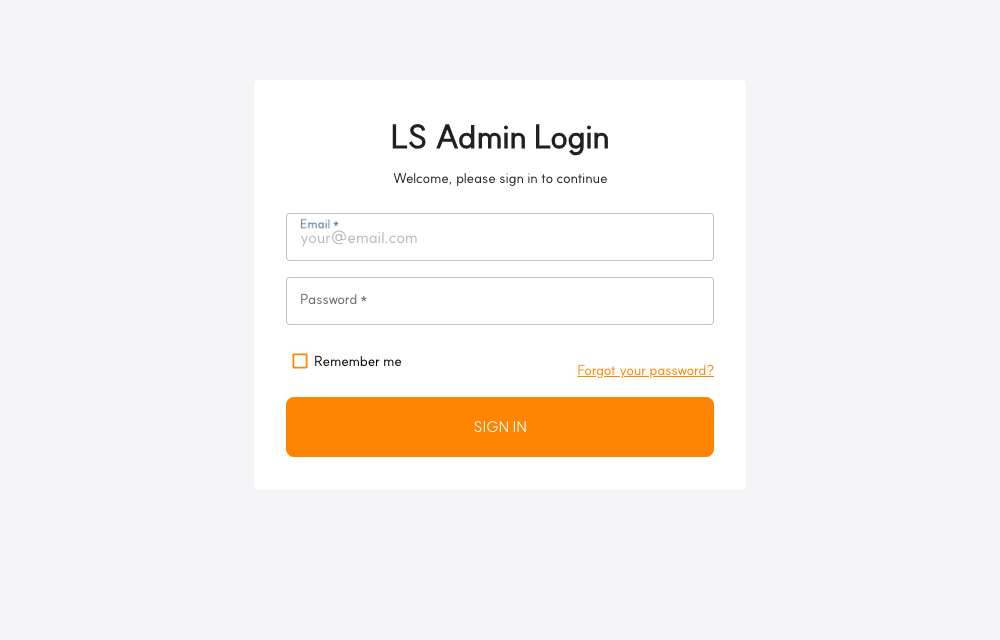

For the initial administrator account and first login, see [section 7.3 of the Installation and Operation Guide](../installation/OpenDID_LedgerService_InstallationAndOperation_Guide.md). For resetting a password with `Forgot your password?`, see section 7.4 of the same guide.

 

## 2.2. Main Screen Configuration

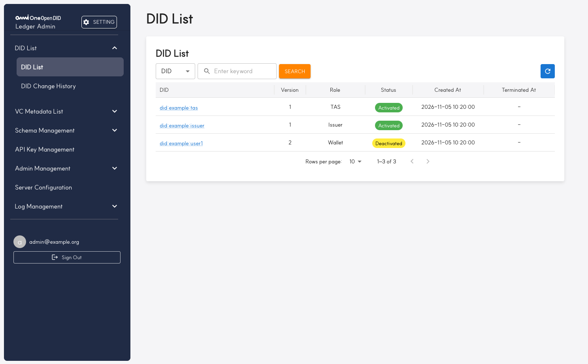

| No. | Area | Description |
| --- | --- | --- |
| 1 | Header area | The `SETTING` button opens the password change screen. |
| 2 | Content area | Shows the title and content of the selected menu. |
| 3 | Side menu | Shows the main menus vertically and expands submenus when needed. |
| 4 | User information area | Shows the ID of the signed-in administrator and the `Sign Out` button. |

 

## 2.3. Menu Configuration

| No. | Menu | Depth | Description |
| --- | --- | --- | --- |
| 1 | **DID List** | 1 | Parent menu for DIDs |
| 2 | └ DID List | 2 | View the DID list and details |
| 3 | └ DID Change History | 2 | View DID status change history |
| 4 | **VC Metadata List** | 1 | Parent menu for VC Metadata |
| 5 | └ VC Metadata List | 2 | View the VC Metadata list and details |
| 6 | └ VC Change History | 2 | View VC status change history |
| 7 | **Schema Management** | 1 | Parent menu for schemas |
| 8 | └ VC Schema List | 2 | View VC Schemas |
| 9 | └ ZKP Credential Schema List | 2 | View ZKP Credential Schemas |
| 10 | └ ZKP Credential Definition List | 2 | View ZKP Credential Definitions |
| 11 | **API Key Management** | 1 | Issue and manage API keys for Agent APIs |
| 12 | **Admin Management** | 1 | Parent menu for administrator settings |
| 13 | └ Admin Management | 2 | Manage administrator accounts |
| 14 | └ Password Policy Settings | 2 | Set the administrator password policy |
| 15 | **Server Configuration** | 1 | Set whether API keys are validated |
| 16 | **Log Management** | 1 | Parent menu for logs |
| 17 | └ API Log | 2 | View Agent API calls |
| 18 | └ Audit API Log | 2 | View administrator API activity |

 

## 2.4. Password Change Management

1. Click `SETTING` in the header area.
2. Select password change in the settings menu.
3. Enter the current password and the new password, and save.

> **Note**: See [Password Policy Settings](#36-password-policy-settings) for the rules that apply.

 

# 3. Feature-Specific Detailed Manual

> Screens were captured with example data. Actual data varies by environment.

## 3.1. DID List

This menu shows the DIDs registered in LSS. It is read-only. DIDs are registered by the TA through Agent APIs.

 

### 3.1.1. DID List View

| No. | Item | Description |
| --- | --- | --- |
| 1 | **Search** | Searches by DID, Role, Status, or Version. Status is selected from Activated, Deactivated, Revoked, and Terminated. |
| 2 | **DID** | DID. Click to open the detail screen. |
| 3 | **Version** | Current DID Document version. |
| 4 | **Role** | Role of the DID owner. Example: `TAS`, `Issuer`, `Wallet` |
| 5 | **Status** | DID status. |
| 6 | **Created At** | Date and time of registration. |
| 7 | **Terminated At** | Date and time of termination. |

 

### 3.1.2. DID Details

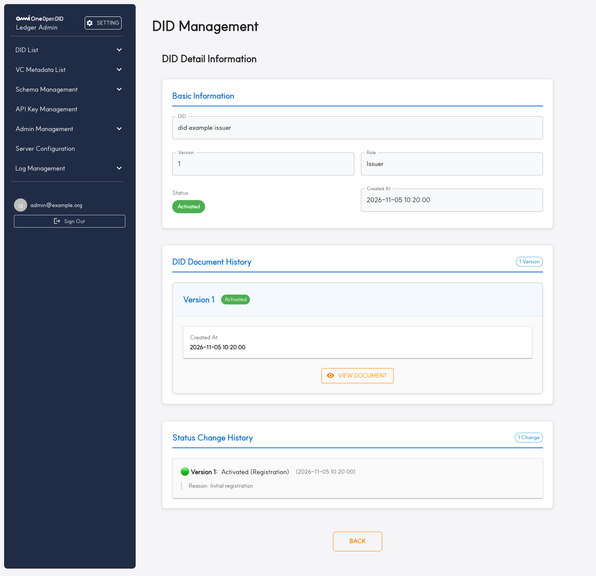

| No. | Item | Description |
| --- | --- | --- |
| 1 | **Basic Information** | Shows DID, Version, Role, Status, and Created At. A terminated DID also shows Terminated At. |
| 2 | **DID Document History** | DID Document history by version. Shows the version, status, Created At, and Revoked At when revoked. |
| 3 | **VIEW DOCUMENT Button** | Shows the DID Document of that version in a popup. |
| 4 | **Status Change History** | Shows status changes by version with the reason and date. |
| 5 | **BACK Button** | Returns to the list. |

 

### 3.1.3. DID Change History

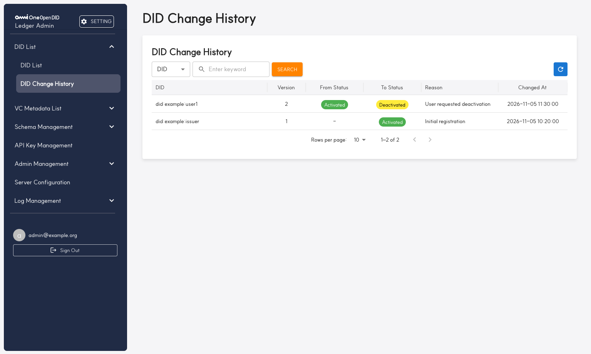

| No. | Item | Description |
| --- | --- | --- |
| 1 | **Search** | Searches by DID, Version, From Status, To Status, or Reason. |
| 2 | **DID** | DID whose status changed. |
| 3 | **Version** | DID Document version. |
| 4 | **From Status** | Status before the change. |
| 5 | **To Status** | Status after the change. |
| 6 | **Reason** | Reason for the change. |
| 7 | **Changed At** | Date and time of the change. |

 

## 3.2. VC Metadata List

This menu shows the VC Metadata registered in LSS. It is read-only.

 

### 3.2.1. VC Metadata List View

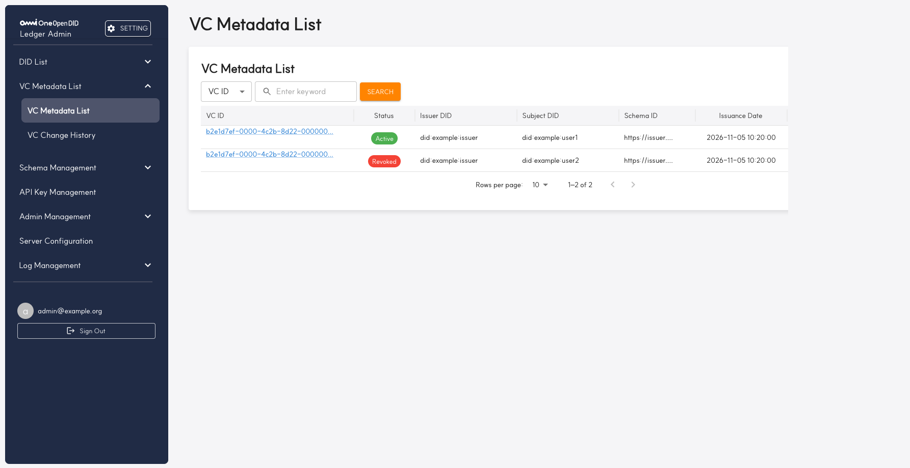

| No. | Item | Description |
| --- | --- | --- |
| 1 | **Search** | Searches by VC ID, Issuer DID, Subject DID, Schema ID, or Status. Status is selected from Active, Inactive, Revoked, and Expired. |
| 2 | **VC ID** | VC identifier. Click to open the detail screen. |
| 3 | **Status** | VC status. |
| 4 | **Issuer DID** | Issuer DID. |
| 5 | **Subject DID** | Holder DID. |
| 6 | **Schema ID** | VC Schema identifier. |
| 7 | **Issuance Date** | Date and time of issuance. |
| 8 | **Valid Until** | End of the validity period. |

 

### 3.2.2. VC Metadata Details

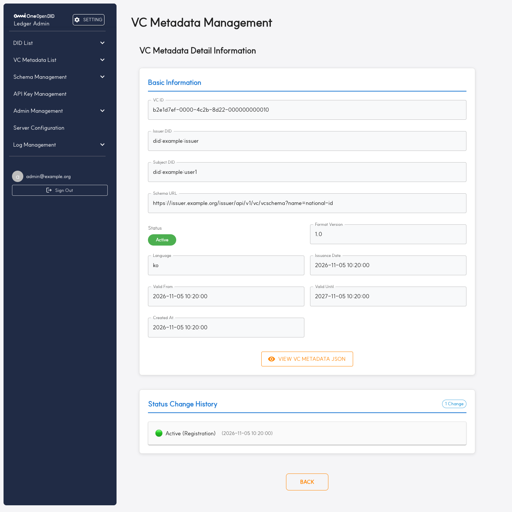

| No. | Item | Description |
| --- | --- | --- |
| 1 | **Basic Information** | Shows VC ID, Issuer DID, Subject DID, Schema URL, Status, Format Version, Language, Issuance Date, Valid From, Valid Until, and Created At. |
| 2 | **VIEW VC METADATA JSON Button** | Shows the VC Metadata JSON in a popup. |
| 3 | **Status Change History** | Shows status changes with the date. |
| 4 | **BACK Button** | Returns to the list. |

 

### 3.2.3. VC Change History

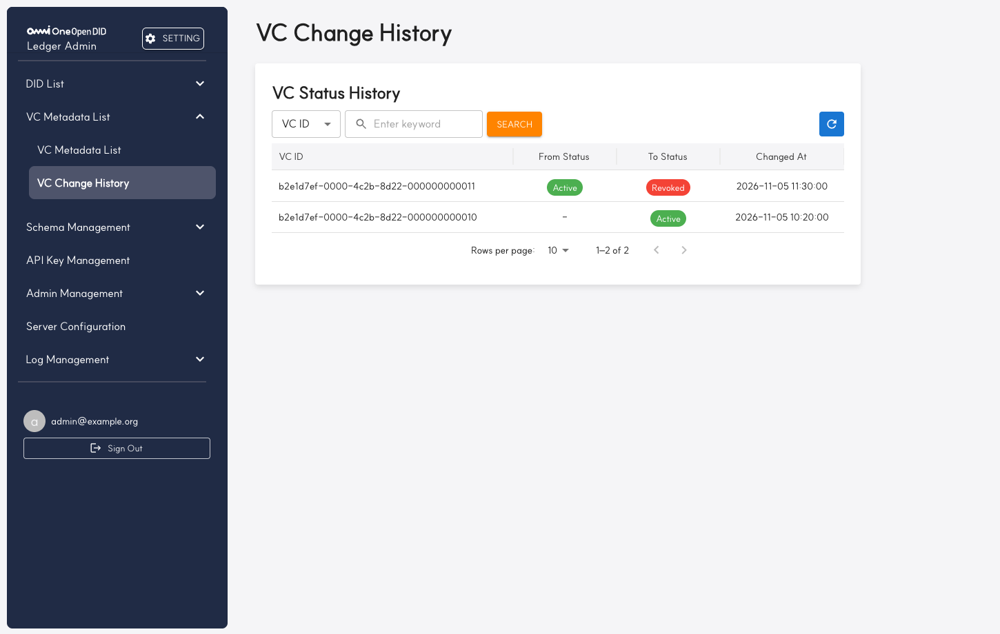

| No. | Item | Description |
| --- | --- | --- |
| 1 | **Search** | Searches by VC ID, From Status, or To Status. |
| 2 | **VC ID** | Identifier of the VC whose status changed. |
| 3 | **From Status** | Status before the change. |
| 4 | **To Status** | Status after the change. |
| 5 | **Changed At** | Date and time of the change. |

 

## 3.3. Schema Management

This menu shows the schemas registered in LSS. It is read-only.

 

### 3.3.1. VC Schema List

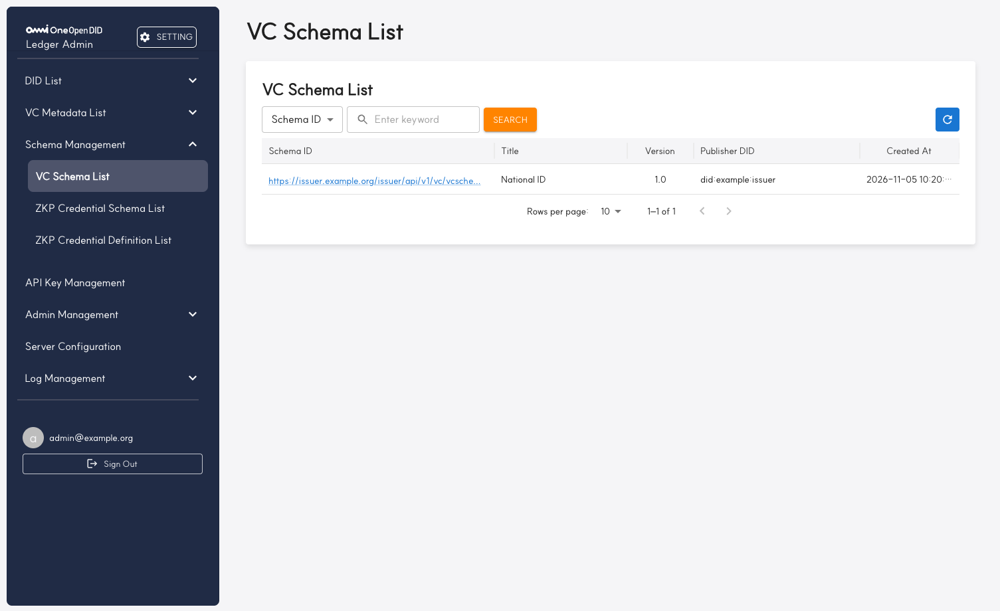

| No. | Item | Description |
| --- | --- | --- |
| 1 | **Search** | Searches by Schema ID, Title, Version, or Publisher DID. |
| 2 | **Schema ID** | VC Schema identifier. Click to open the detail screen. |
| 3 | **Title** | Schema title. |
| 4 | **Version** | Schema version. |
| 5 | **Publisher DID** | DID of the party that registered the schema. |
| 6 | **Created At** | Date and time of registration. |

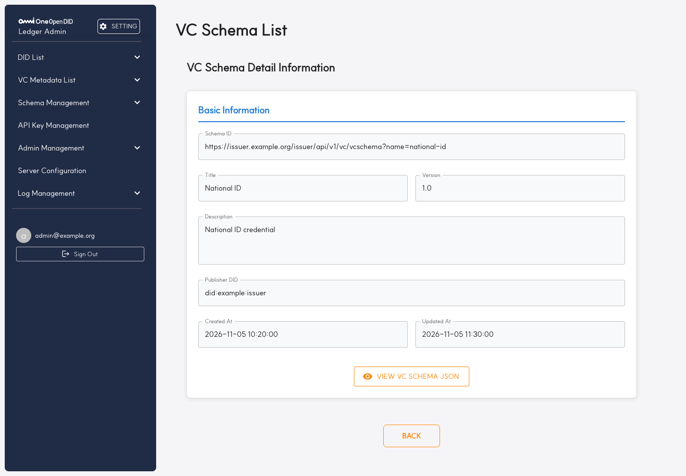

The detail screen shows Schema ID, Title, Version, Description, Publisher DID, Created At, and Updated At, and a button shows the VC Schema JSON in a popup. `BACK` returns to the list.

 

### 3.3.2. ZKP Credential Schema List

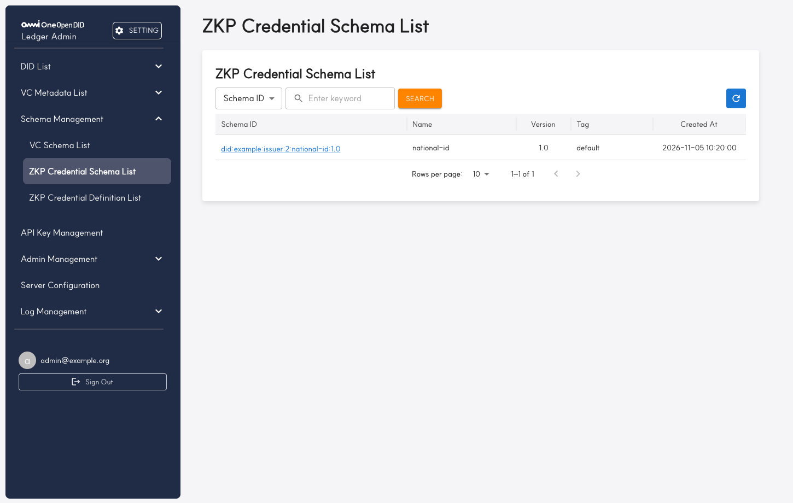

| No. | Item | Description |
| --- | --- | --- |
| 1 | **Search** | Searches by Schema ID, Name, Version, or Tag. |
| 2 | **Schema ID** | Credential Schema identifier. Click to open the detail screen. |
| 3 | **Name** | Schema name. |
| 4 | **Version** | Schema version. |
| 5 | **Tag** | Tag. |
| 6 | **Created At** | Date and time of registration. |

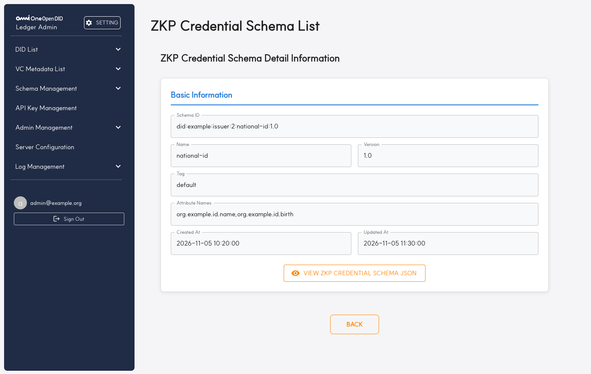

The detail screen shows Schema ID, Name, Version, Tag, Attribute Names, Created At, and Updated At, and a button shows the Credential Schema JSON in a popup.

 

### 3.3.3. ZKP Credential Definition List

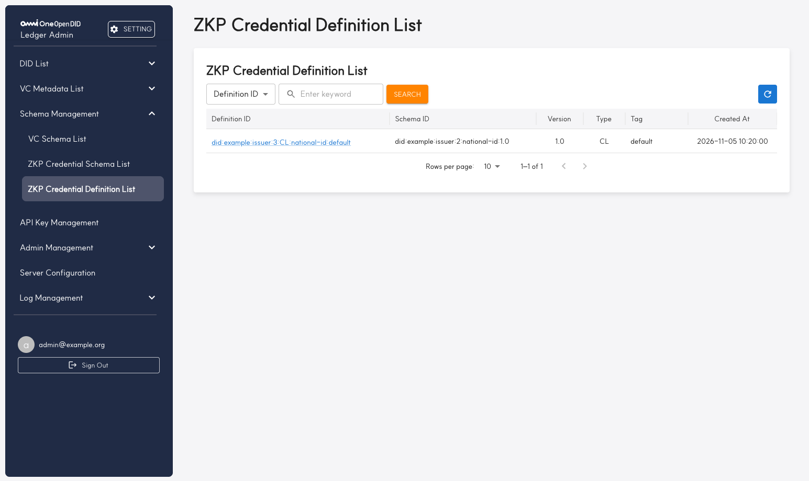

| No. | Item | Description |
| --- | --- | --- |
| 1 | **Search** | Searches by Definition ID, Schema ID, Version, or Tag. |
| 2 | **Definition ID** | Credential Definition identifier. Click to open the detail screen. |
| 3 | **Schema ID** | Identifier of the linked Credential Schema. |
| 4 | **Version** | Version. |
| 5 | **Type** | Type. Example: `CL` |
| 6 | **Tag** | Tag. |
| 7 | **Created At** | Date and time of registration. |

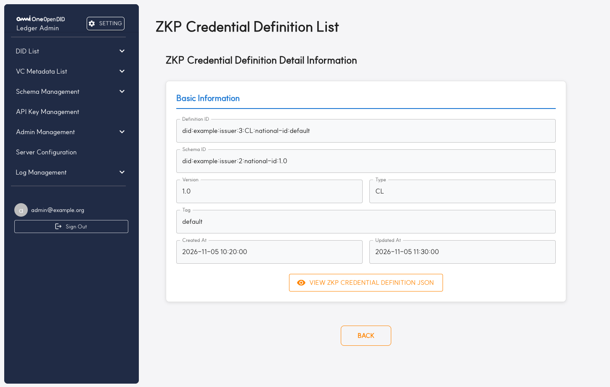

The detail screen shows Definition ID, Schema ID, Version, Type, Tag, Created At, and Updated At, and a button shows the Credential Definition JSON in a popup.

 

## 3.4. API Key Management

This menu issues and manages the API keys that other servers use to call Agent APIs (`/lss/api/v1`). For the APIs available to each role and the error codes, see [chapter 8 of the Installation and Operation Guide](../installation/OpenDID_LedgerService_InstallationAndOperation_Guide.md).

 

### 3.4.1. API Key List

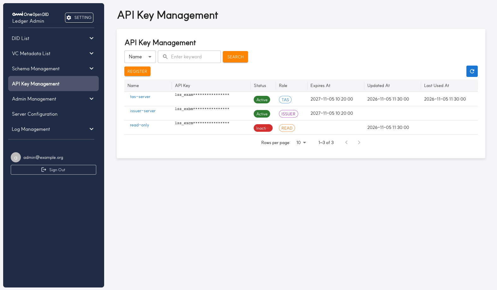

| No. | Item | Description |
| --- | --- | --- |
| 1 | **Search** | Searches by Name, Role (TAS, ISSUER, READ), or Status (Active, Inactive). |
| 2 | **REGISTER Button** | Opens the API key issuance dialog. |
| 3 | **Name** | API key name. Click to open the detail dialog. |
| 4 | **API Key** | Partially masked API key. |
| 5 | **Status** | `Active` or `Inactive`. |
| 6 | **Role** | One of `TAS`, `ISSUER`, and `READ`. |
| 7 | **Expires At** | Expiration date and time. |
| 8 | **Updated At** | Date and time of the last modification. |
| 9 | **Last Used At** | Date and time of the last use. |

 

### 3.4.2. Issue an API Key

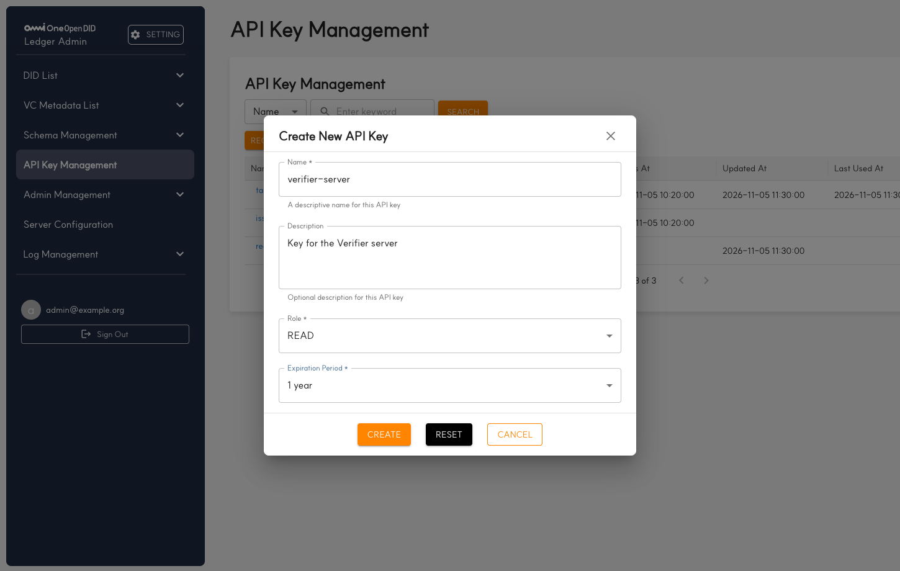

| No. | Item | Description |
| --- | --- | --- |
| 1 | **Name*** | Name that identifies the API key (up to 100 characters). Example: `verifier-server` |
| 2 | **Description** | Purpose (up to 500 characters). Example: `Key for the Verifier server` |
| 3 | **Role*** | Select from `TAS`, `ISSUER`, and `READ`. |
| 4 | **Expiration Period*** | Select from `1 month`, `3 months`, `6 months`, `1 year`, `2 years`, `No Limit`, and `Custom`. |
| 5 | **Custom Expiration Days*** | Enter the number of days when `Custom` is selected (30 to 36525). |
| 6 | **CREATE Button** | Issues the API key. |
| 7 | **RESET Button** | Resets the input. |
| 8 | **CANCEL Button** | Cancels the issuance. |

When issuance is complete, an API key starting with `lss_` is shown.

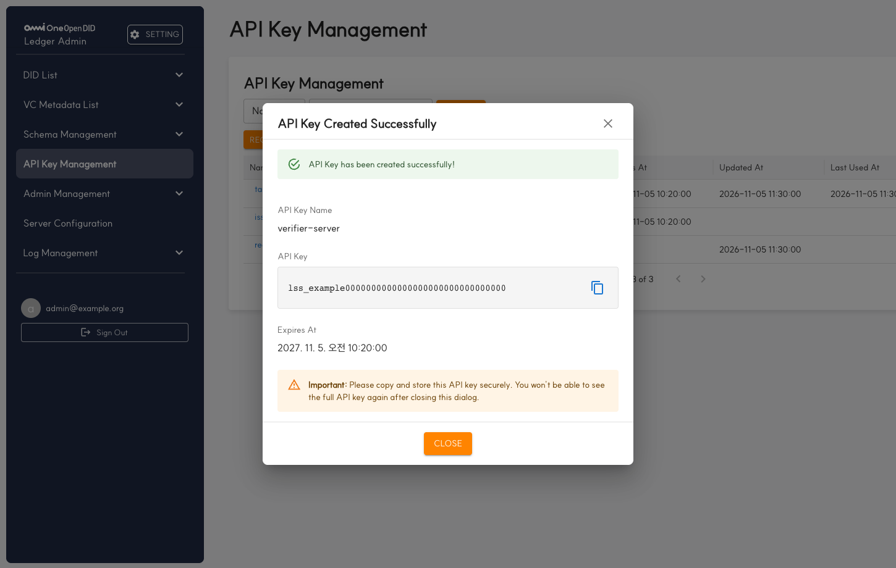

> **Caution**: The plaintext API key is shown only once on this screen. Copy it before closing the dialog and deliver it securely to the calling server.

 

### 3.4.3. API Key Details, Renewal, and Deactivation

Click Name in the list to open the detail dialog.

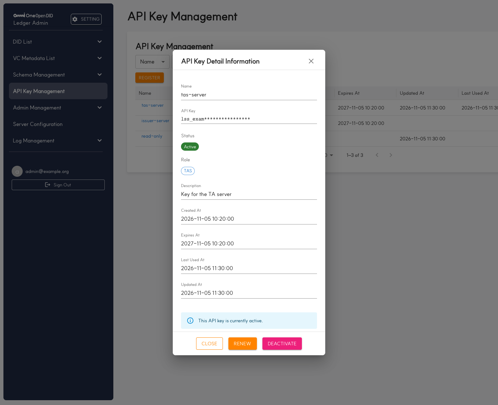

| No. | Item | Description |
| --- | --- | --- |
| 1 | **Status, Role** | Current status and role. |
| 2 | **Name, API Key, Description** | Name, partially masked API key, and description. |
| 3 | **Created At, Expires At, Last Used At, Updated At** | Dates of creation, expiration, last use, and last modification. |
| 4 | **CLOSE Button** | Closes the dialog. |
| 5 | **RENEW Button** | Extends the expiration date while Active. |
| 6 | **DEACTIVATE Button** | Shown while Active. Deactivates the API key. |
| 7 | **ACTIVATE Button** | Shown while Inactive. Activates the API key again. |

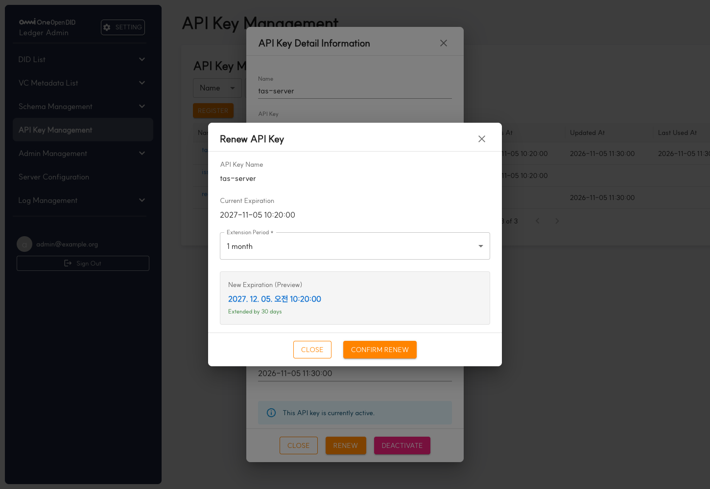

In the renewal dialog, select `Extension Period` (and `Custom Extension Days` for `Custom`). Check the new expiration in `New Expiration (Preview)`, then renew. The API key value does not change.

 

## 3.5. Admin Management

The `Admin Management` menu manages the administrator accounts that can access the LSS Admin Console.

When the LSS server is installed, the `admin@opendid.omnione.net` account is created automatically with ROOT permission. It is the only ROOT account in the system and cannot be deleted.

Administrator accounts have two permission types: **ROOT** and **Normal Admin**.

`REGISTER`, `DELETE`, and `CHANGE PASSWORD` are used by ROOT administrators.

 

### 3.5.1. Admin List

The `Admin Management` menu shows the list of registered administrator accounts.

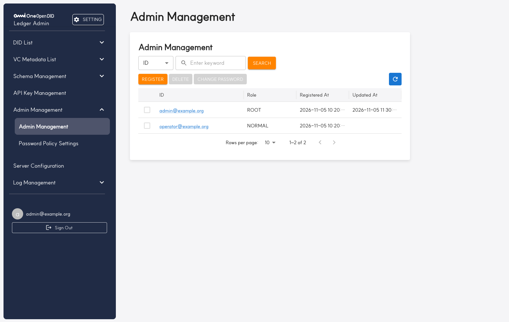

| No. | Item | Description |
| --- | --- | --- |
| 1 | **Search** | Searches by ID or Role (Root, Normal). |
| 2 | **REGISTER Button** | Opens the screen for registering a new administrator account. |
| 3 | **DELETE Button** | Deletes the selected administrator account. Only ROOT can do this. |
| 4 | **CHANGE PASSWORD Button** | Changes the password of the selected administrator account. |
| 5 | **ID** | Email ID of the administrator account. |
| 6 | **Role** | Permission of the administrator account. |
| 7 | **Registered At** | Date and time the account was registered. |
| 8 | **Updated At** | Date and time of the last modification. |

 

### 3.5.2. Admin Registration

Click `REGISTER` to open the registration screen.

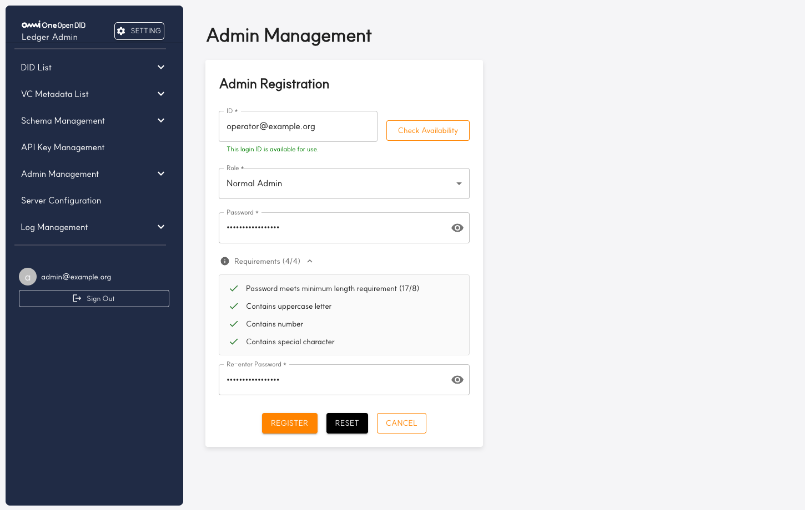

| No. | Item | Description |
| --- | --- | --- |
| 1 | **ID*** | ID of the administrator account. Use an email address of 3 to 30 characters. Example: `operator@example.org` |
| 2 | **Check Availability Button** | Checks that the ID is not already in use. The check must pass before registering. |
| 3 | **Role** | Select the permission of the account. Example: `Normal Admin` |
| 4 | **Password*** | Password used to sign in (8 to 30 characters). If the password policy is on, its rules also apply. |
| 5 | **Re-enter Password*** | Enter the password again. |
| 6 | **REGISTER Button** | Registers the administrator account with the entered information. |
| 7 | **RESET Button** | Resets the input. |
| 8 | **CANCEL Button** | Cancels and returns to the previous screen. |

 

## 3.6. Password Policy Settings

`Admin Management > Password Policy Settings` sets the password rules for administrators. The rules apply when an account is registered and when a password is changed.

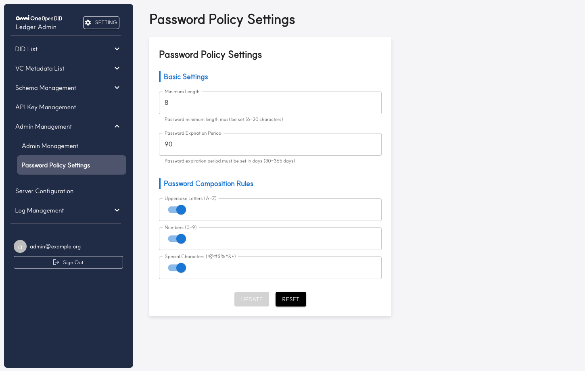

| No. | Item | Description |
| --- | --- | --- |
| 1 | **Minimum Length** | Minimum password length, from 6 to 20 characters. The default is 8. |
| 2 | **Password Expiration Period** | Password expiration period, from 30 to 365 days. The default is 365. |
| 3 | **Uppercase Letters (A-Z)** | Requires at least one uppercase letter. Off by default. |
| 4 | **Numbers (0-9)** | Requires at least one number. Off by default. |
| 5 | **Special Characters (!@#$%^&*)** | Requires at least one special character. Off by default. |
| 6 | **UPDATE Button** | Saves the policy. If no policy is registered yet, the button is named `REGISTER`. |
| 7 | **RESET Button** | Reverts to the input before the change. |

## 3.7. Server Configuration

`Server Configuration` sets whether Agent APIs validate API keys.

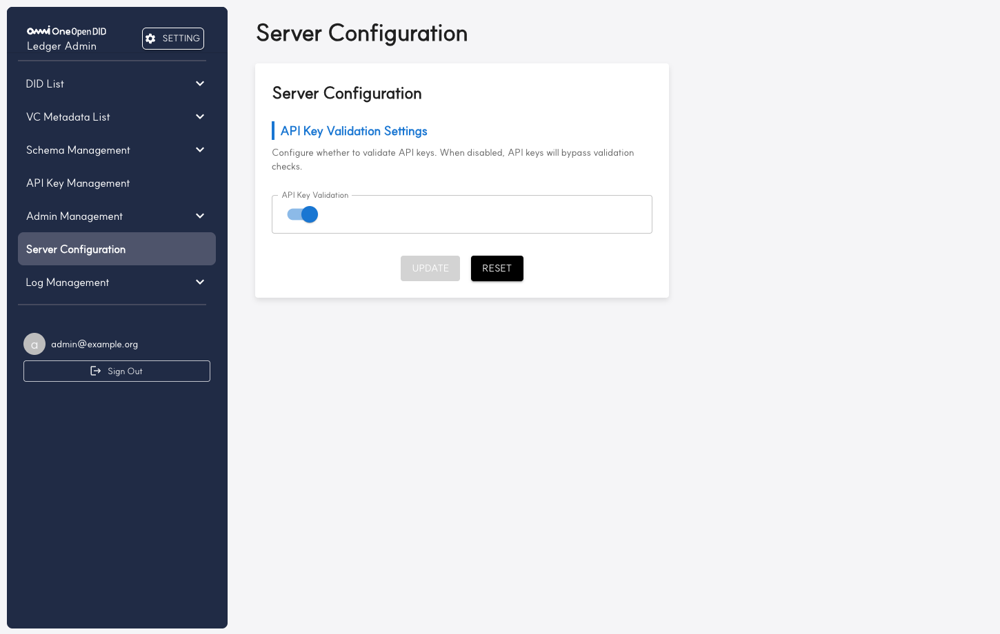

| No. | Item | Description |
| --- | --- | --- |
| 1 | **API Key Validation** | When on, Agent API calls are validated with API keys. It is stored as `API_KEY_VALIDATION_ENABLED` and is off by default. It applies to later requests without a server restart. |
| 2 | **UPDATE Button** | Saves the setting. |
| 3 | **RESET Button** | Reverts the input before saving. |

> **Caution**: With the default value, all Agent APIs can be called without an API key. In production, set API keys on the calling servers first and then turn this on. For the order, see section 8.4 of the [Installation and Operation Guide](../installation/OpenDID_LedgerService_InstallationAndOperation_Guide.md).

## 3.8. Log Management

Once LSS is registered, API call records are available under `Log Management` in the sidebar. Both screens show the newest records first, page by page, and the refresh button reloads the list. Click `Called At` to open the detail dialog. Logs are read-only.

 

### 3.8.1. API Log

`Log Management > API Log` (`/logs/api`) shows LSS Agent API calls.

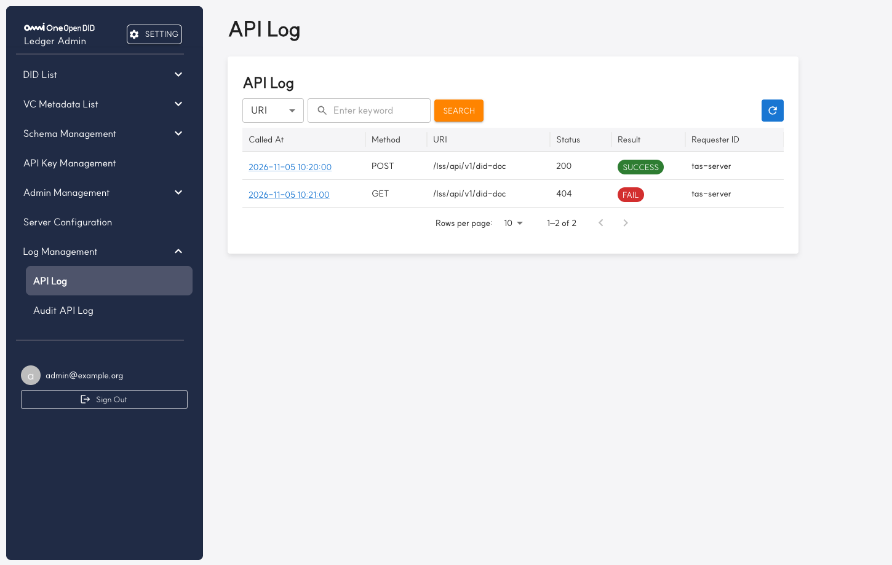

| No. | Item | Description |
| --- | --- | --- |
| 1 | **Search** | Searches by `URI` or `Result` (`SUCCESS`, `FAIL`). |
| 2 | **Called At** | Date and time of the call. Click to open the detail dialog. |
| 3 | **Method** | HTTP method. |
| 4 | **URI** | Called URI. |
| 5 | **Status** | HTTP status code. |
| 6 | **Result** | `SUCCESS` or `FAIL`. |
| 7 | **Requester ID** | Requester ID. |

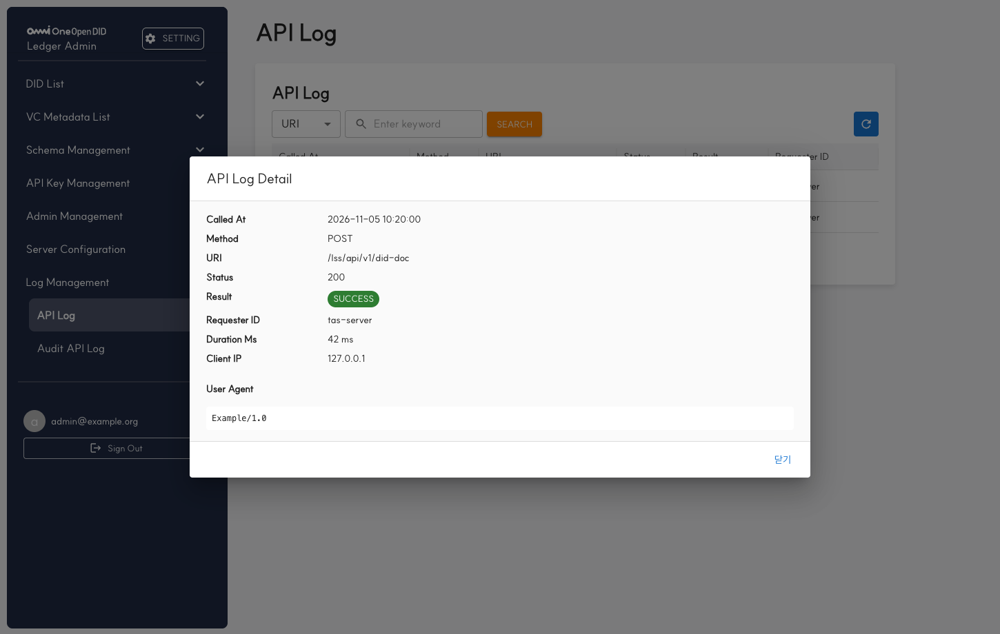

In addition to the list items, the detail dialog shows the following.

| Item | Description |
| --- | --- |
| **Duration Ms** | Processing time in milliseconds. |
| **Client IP** | Client IP address. |
| **User Agent** | User Agent of the request. |
| **Message** | Shown when an error message was recorded. |

 

### 3.8.2. Audit API Log

`Log Management > Audit API Log` (`/logs/audit`) shows administrator operations performed through Admin APIs.

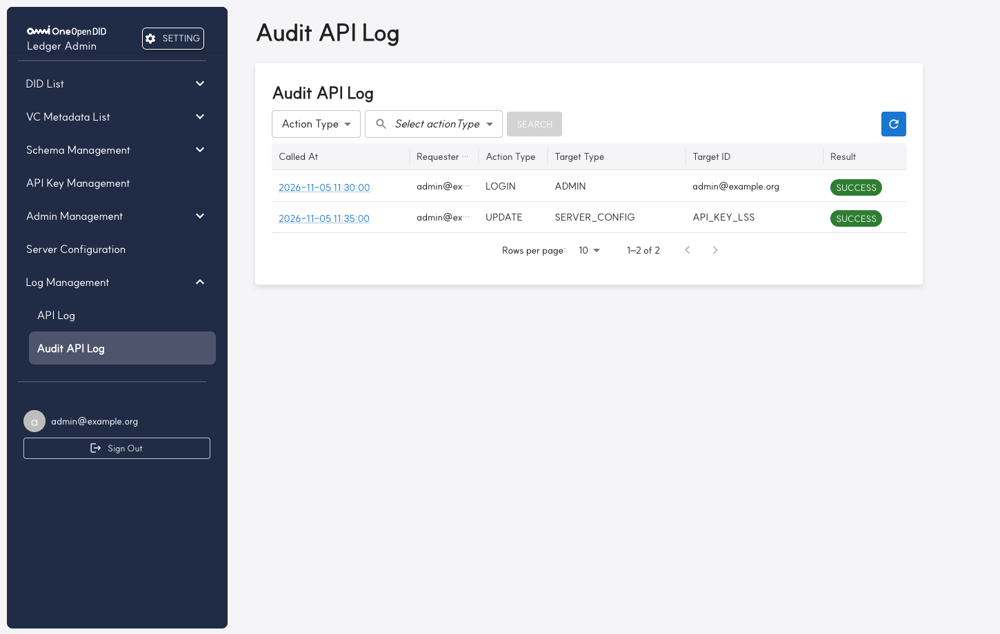

| No. | Item | Description |
| --- | --- | --- |
| 1 | **Search** | Searches by `Action Type`, `Target Type`, `Result`, or `Requester ID`. `Action Type` is selected from `NONE`, `CREATE`, `UPDATE`, `DELETE`, `LOGIN`, and `LOGOUT`. |
| 2 | **Called At** | Date and time of the call. Click to open the detail dialog. |
| 3 | **Requester ID** | ID of the administrator who performed the operation. |
| 4 | **Action Type** | Operation type. |
| 5 | **Target Type** | Type of the target. |
| 6 | **Target ID** | ID of the target. |
| 7 | **Result** | `SUCCESS` or `FAIL`. |

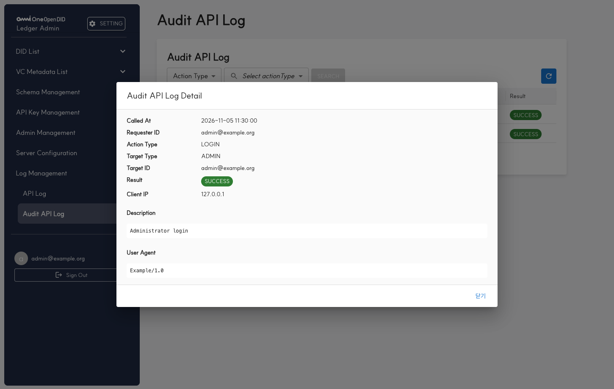

In addition to the list items, the detail dialog shows the following.

| Item | Description |
| --- | --- |
| **Client IP** | Client IP address. |
| **Description** | Description of the operation. |
| **User Agent** | User Agent of the request. |
| **Message** | Shown when an error message was recorded. |

> Logs are created from API calls that use `@ArticleLog` on the server. If the result is `FAIL`, check the status code in API Log and the detail message of that log.

