---
puppeteer:
    pdf:
        format: A4
        displayHeaderFooter: true
        landscape: false
        scale: 0.8
        margin:
            top: 1.2cm
            right: 1cm
            bottom: 1cm
            left: 1cm
    image:
        quality: 100
        fullPage: false
---

OpenDID Ledger Service Admin Operation Guide
==

- Date: 2026-11-06
- Version: v3.0.0

개정 이력
==
| 버전 | 일자 | 변경 내용 |
| ---- | ---- | --------- |
| v3.0.0 | 2026-11-06 | 최초 작성 |

목차
==

- [개정 이력](#개정-이력)
- [목차](#목차)
- [1. 소개](#1-소개)
  - [1.1. 개요](#11-개요)
  - [1.2. Admin Console 정의](#12-admin-console-정의)
- [2. 기본 메뉴얼](#2-기본-메뉴얼)
  - [2.1. 로그인](#21-로그인)
  - [2.2. 메인 화면 구성](#22-메인-화면-구성)
  - [2.3. 메뉴 구성](#23-메뉴-구성)
  - [2.4. 비밀번호 변경 관리](#24-비밀번호-변경-관리)
- [3. 기능별 상세 메뉴얼](#3-기능별-상세-메뉴얼)
  - [3.1. DID List](#31-did-list)
    - [3.1.1. DID 목록 조회](#311-did-목록-조회)
    - [3.1.2. DID 상세 정보](#312-did-상세-정보)
    - [3.1.3. DID Change History](#313-did-change-history)
  - [3.2. VC Metadata List](#32-vc-metadata-list)
    - [3.2.1. VC Metadata 목록 조회](#321-vc-metadata-목록-조회)
    - [3.2.2. VC Metadata 상세 정보](#322-vc-metadata-상세-정보)
    - [3.2.3. VC Change History](#323-vc-change-history)
  - [3.3. Schema Management](#33-schema-management)
    - [3.3.1. VC Schema List](#331-vc-schema-list)
    - [3.3.2. ZKP Credential Schema List](#332-zkp-credential-schema-list)
    - [3.3.3. ZKP Credential Definition List](#333-zkp-credential-definition-list)
  - [3.4. API Key Management](#34-api-key-management)
    - [3.4.1. API Key 목록 조회](#341-api-key-목록-조회)
    - [3.4.2. API Key 발급](#342-api-key-발급)
    - [3.4.3. API Key 상세와 갱신, 비활성화](#343-api-key-상세와-갱신-비활성화)
  - [3.5. Admin Management](#35-admin-management)
    - [3.5.1. Admin 목록 조회](#351-admin-목록-조회)
    - [3.5.2. Admin 등록](#352-admin-등록)
  - [3.6. Password Policy Settings](#36-password-policy-settings)
  - [3.7. Server Configuration](#37-server-configuration)
  - [3.8. Log Management](#38-log-management)
    - [3.8.1. API Log](#381-api-log)
    - [3.8.2. Audit API Log](#382-audit-api-log)

 

# 1. 소개

## 1.1. 개요

본 문서는 Open DID Ledger Service(LSS) Admin Console의 사용 방법을 안내합니다. 설치, 설정, API Key 운영 절차는 [설치 및 운영 가이드](../installation/OpenDID_LedgerService_InstallationAndOperation_Guide_ko.md)를 참고하세요.

## 1.2. Admin Console 정의

LSS Admin Console은 Ledger Service 서버를 관리하는 웹 기반 관리 도구입니다. 주요 기능은 다음과 같습니다.

- DID, VC Metadata, VC Schema, ZKP Credential Schema, ZKP Credential Definition 조회
- 상태 변경 이력 조회
- API Key 발급과 관리
- 관리자 계정과 비밀번호 정책 관리
- API Key 검증 사용 설정
- API 호출 및 관리자 작업 로그 조회

 

# 2. 기본 메뉴얼

## 2.1. 로그인

1. 웹 브라우저에서 `http://<lss_domain>:8098/`에 접속합니다.
2. 관리자 ID와 비밀번호를 입력합니다.
3. `SIGN IN` 버튼을 클릭합니다.

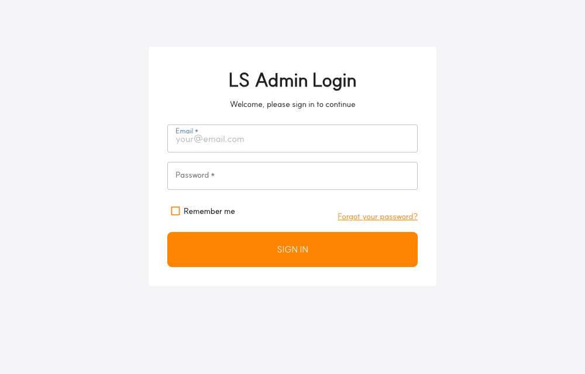

초기 관리자 계정과 최초 로그인 절차는 [설치 및 운영 가이드 7.3](../installation/OpenDID_LedgerService_InstallationAndOperation_Guide_ko.md#73-최초-로그인-및-초기-설정)을, `Forgot your password?`로 비밀번호를 재설정하는 절차는 [7.4](../installation/OpenDID_LedgerService_InstallationAndOperation_Guide_ko.md#74-비밀번호-분실-시-재설정)를 참고하세요.

 

## 2.2. 메인 화면 구성

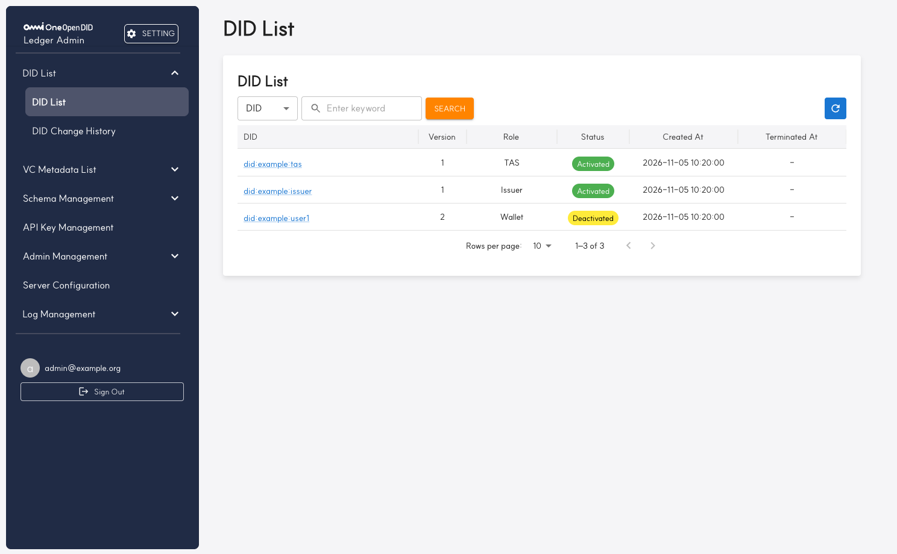

| 번호 | 영역 | 설명 |
| --- | --- | --- |
| 1 | 헤더 영역 | `SETTING` 버튼으로 비밀번호 변경 화면을 엽니다. |
| 2 | 콘텐츠 영역 | 선택한 메뉴의 제목과 내용이 표시됩니다. |
| 3 | 사이드 메뉴 | 주요 메뉴가 세로로 표시되며, 필요한 경우 하위 메뉴가 펼쳐집니다. |
| 4 | 사용자 정보 영역 | 로그인한 관리자의 ID와 `Sign Out` 버튼이 표시됩니다. |

 

## 2.3. 메뉴 구성

| 번호 | 메뉴 | Depth | 설명 |
| --- | --- | --- | --- |
| 1 | **DID List** | 1 | DID 상위 메뉴 |
| 2 | └ DID List | 2 | DID 목록과 상세 조회 |
| 3 | └ DID Change History | 2 | DID 상태 변경 이력 조회 |
| 4 | **VC Metadata List** | 1 | VC Metadata 상위 메뉴 |
| 5 | └ VC Metadata List | 2 | VC Metadata 목록과 상세 조회 |
| 6 | └ VC Change History | 2 | VC 상태 변경 이력 조회 |
| 7 | **Schema Management** | 1 | 스키마 상위 메뉴 |
| 8 | └ VC Schema List | 2 | VC Schema 조회 |
| 9 | └ ZKP Credential Schema List | 2 | ZKP Credential Schema 조회 |
| 10 | └ ZKP Credential Definition List | 2 | ZKP Credential Definition 조회 |
| 11 | **API Key Management** | 1 | Agent API용 API Key 발급과 관리 |
| 12 | **Admin Management** | 1 | 관리자 설정 상위 메뉴 |
| 13 | └ Admin Management | 2 | 관리자 계정 관리 |
| 14 | └ Password Policy Settings | 2 | 관리자 비밀번호 정책 설정 |
| 15 | **Server Configuration** | 1 | API Key 검증 사용 설정 |
| 16 | **Log Management** | 1 | 로그 상위 메뉴 |
| 17 | └ API Log | 2 | Agent API 호출 기록 조회 |
| 18 | └ Audit API Log | 2 | 관리자 API 작업 기록 조회 |

 

## 2.4. 비밀번호 변경 관리

1. 헤더 영역의 `SETTING` 버튼을 클릭합니다.
2. 설정 메뉴에서 비밀번호 변경을 선택합니다.
3. 현재 비밀번호와 새 비밀번호를 입력하고 저장합니다.

> **참고**: 적용되는 규칙은 [Password Policy Settings](#36-password-policy-settings)에서 확인합니다.

 

# 3. 기능별 상세 메뉴얼

> 화면은 예시 데이터로 캡처했습니다. 실제 데이터는 환경에 따라 달라집니다.

## 3.1. DID List

LSS에 등록된 DID를 조회합니다. 조회 전용이며, DID는 TA가 Agent API로 등록합니다.

 

### 3.1.1. DID 목록 조회

| 번호 | 항목 | 설명 |
| --- | --- | --- |
| 1 | **검색** | DID, Role, Status, Version으로 검색합니다. Status는 Activated, Deactivated, Revoked, Terminated 중에서 선택합니다. |
| 2 | **DID** | DID입니다. 클릭하면 상세 화면으로 이동합니다. |
| 3 | **Version** | 현재 DID Document 버전입니다. |
| 4 | **Role** | DID 소유자의 역할입니다. 예: `TAS`, `Issuer`, `Wallet` |
| 5 | **Status** | DID 상태입니다. |
| 6 | **Created At** | 등록 일시입니다. |
| 7 | **Terminated At** | 종료 일시입니다. |

 

### 3.1.2. DID 상세 정보

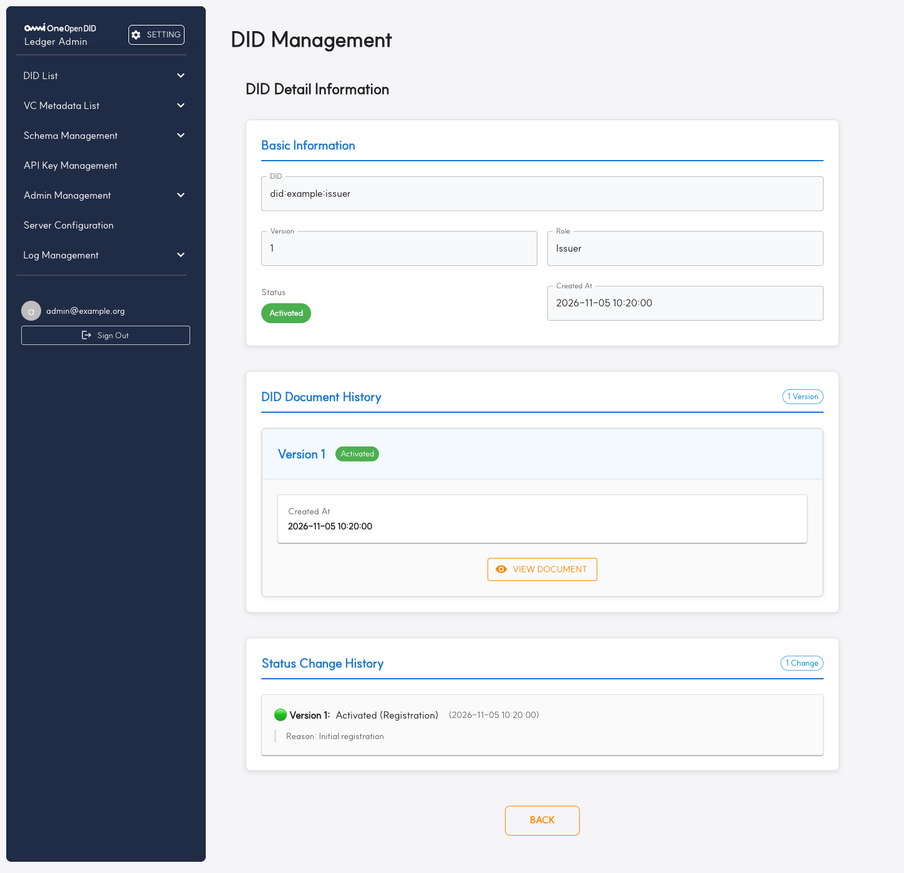

| 번호 | 항목 | 설명 |
| --- | --- | --- |
| 1 | **Basic Information** | DID, Version, Role, Status, Created At을 표시합니다. 종료된 DID는 Terminated At도 표시합니다. |
| 2 | **DID Document History** | DID Document의 버전별 이력입니다. 버전, 상태, Created At과 폐기된 경우 Revoked At을 표시합니다. |
| 3 | **VIEW DOCUMENT 버튼** | 해당 버전의 DID Document를 팝업으로 표시합니다. |
| 4 | **Status Change History** | 버전별 상태 변경 내역과 사유, 일시를 표시합니다. |
| 5 | **BACK 버튼** | 목록 화면으로 돌아갑니다. |

 

### 3.1.3. DID Change History

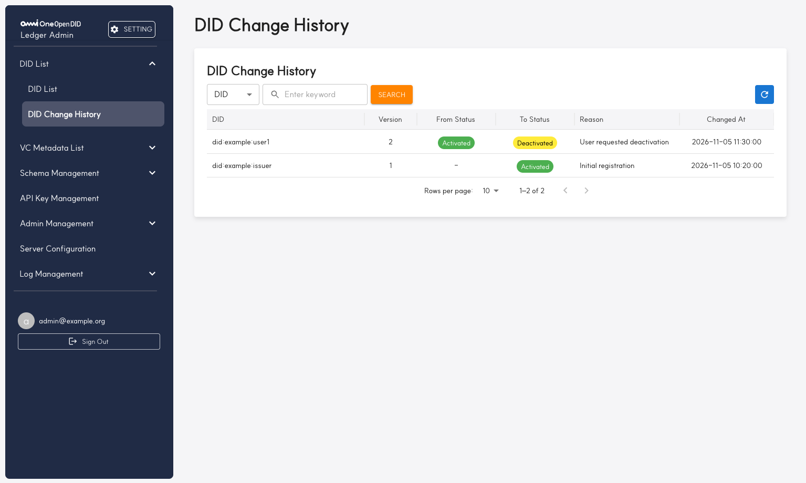

| 번호 | 항목 | 설명 |
| --- | --- | --- |
| 1 | **검색** | DID, Version, From Status, To Status, Reason으로 검색합니다. |
| 2 | **DID** | 상태가 변경된 DID입니다. |
| 3 | **Version** | DID Document 버전입니다. |
| 4 | **From Status** | 변경 전 상태입니다. |
| 5 | **To Status** | 변경 후 상태입니다. |
| 6 | **Reason** | 변경 사유입니다. |
| 7 | **Changed At** | 변경 일시입니다. |

 

## 3.2. VC Metadata List

LSS에 등록된 VC Metadata를 조회합니다. 조회 전용입니다.

 

### 3.2.1. VC Metadata 목록 조회

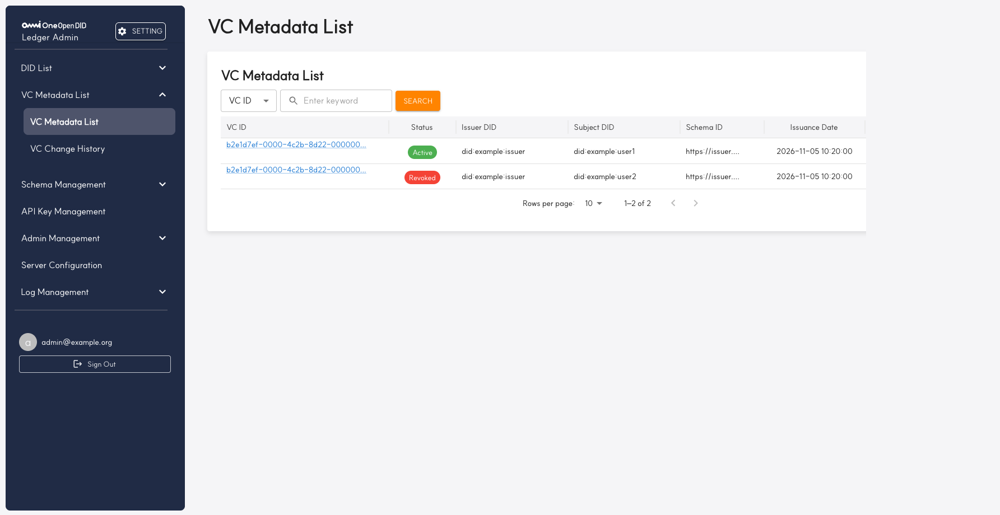

| 번호 | 항목 | 설명 |
| --- | --- | --- |
| 1 | **검색** | VC ID, Issuer DID, Subject DID, Schema ID, Status로 검색합니다. Status는 Active, Inactive, Revoked, Expired 중에서 선택합니다. |
| 2 | **VC ID** | VC 식별자입니다. 클릭하면 상세 화면으로 이동합니다. |
| 3 | **Status** | VC 상태입니다. |
| 4 | **Issuer DID** | 발급자 DID입니다. |
| 5 | **Subject DID** | 소유자 DID입니다. |
| 6 | **Schema ID** | VC Schema 식별자입니다. |
| 7 | **Issuance Date** | 발급 일시입니다. |
| 8 | **Valid Until** | 유효 기간 종료 일시입니다. |

 

### 3.2.2. VC Metadata 상세 정보

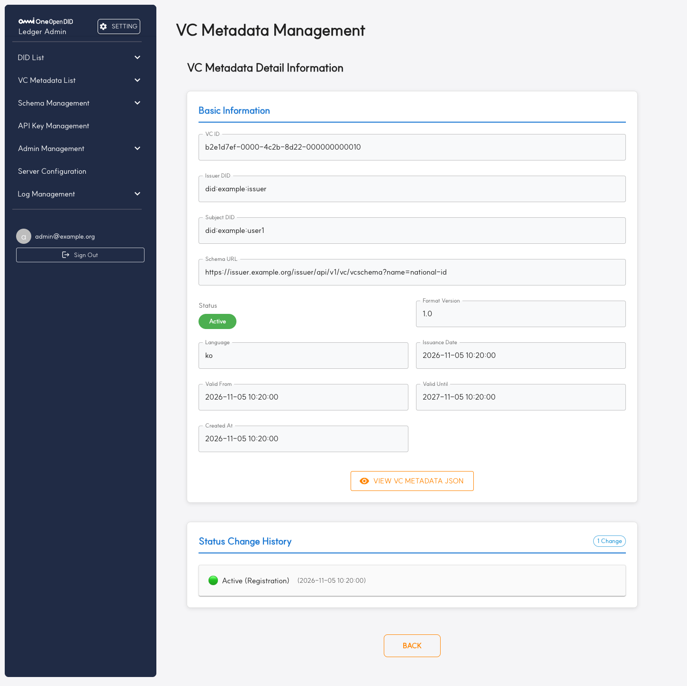

| 번호 | 항목 | 설명 |
| --- | --- | --- |
| 1 | **Basic Information** | VC ID, Issuer DID, Subject DID, Schema URL, Status, Format Version, Language, Issuance Date, Valid From, Valid Until, Created At을 표시합니다. |
| 2 | **VIEW VC METADATA JSON 버튼** | VC Metadata JSON을 팝업으로 표시합니다. |
| 3 | **Status Change History** | 상태 변경 내역과 일시를 표시합니다. |
| 4 | **BACK 버튼** | 목록 화면으로 돌아갑니다. |

 

### 3.2.3. VC Change History

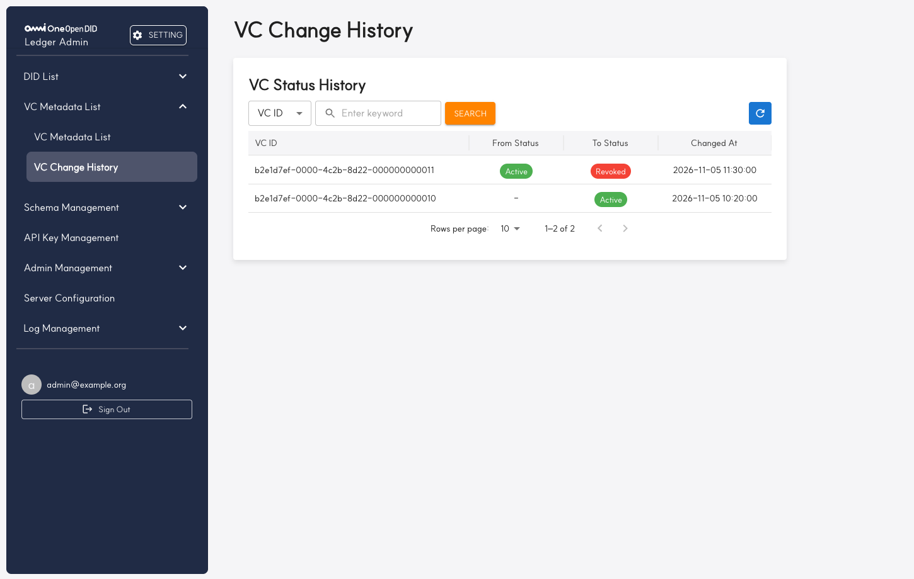

| 번호 | 항목 | 설명 |
| --- | --- | --- |
| 1 | **검색** | VC ID, From Status, To Status로 검색합니다. |
| 2 | **VC ID** | 상태가 변경된 VC 식별자입니다. |
| 3 | **From Status** | 변경 전 상태입니다. |
| 4 | **To Status** | 변경 후 상태입니다. |
| 5 | **Changed At** | 변경 일시입니다. |

 

## 3.3. Schema Management

LSS에 등록된 스키마를 조회합니다. 조회 전용입니다.

 

### 3.3.1. VC Schema List

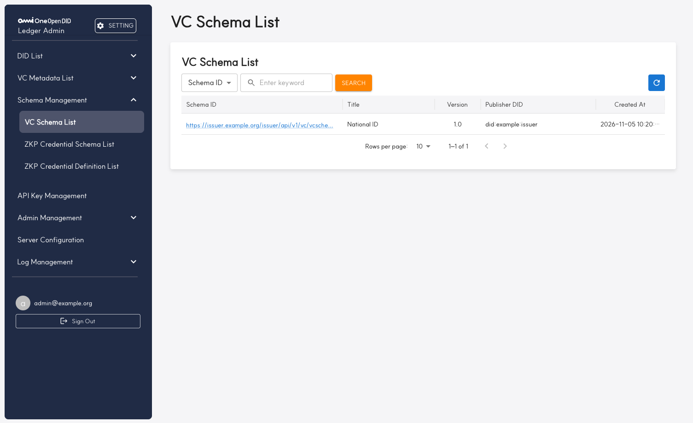

| 번호 | 항목 | 설명 |
| --- | --- | --- |
| 1 | **검색** | Schema ID, Title, Version, Publisher DID로 검색합니다. |
| 2 | **Schema ID** | VC Schema 식별자입니다. 클릭하면 상세 화면으로 이동합니다. |
| 3 | **Title** | 스키마 제목입니다. |
| 4 | **Version** | 스키마 버전입니다. |
| 5 | **Publisher DID** | 스키마를 등록한 주체의 DID입니다. |
| 6 | **Created At** | 등록 일시입니다. |

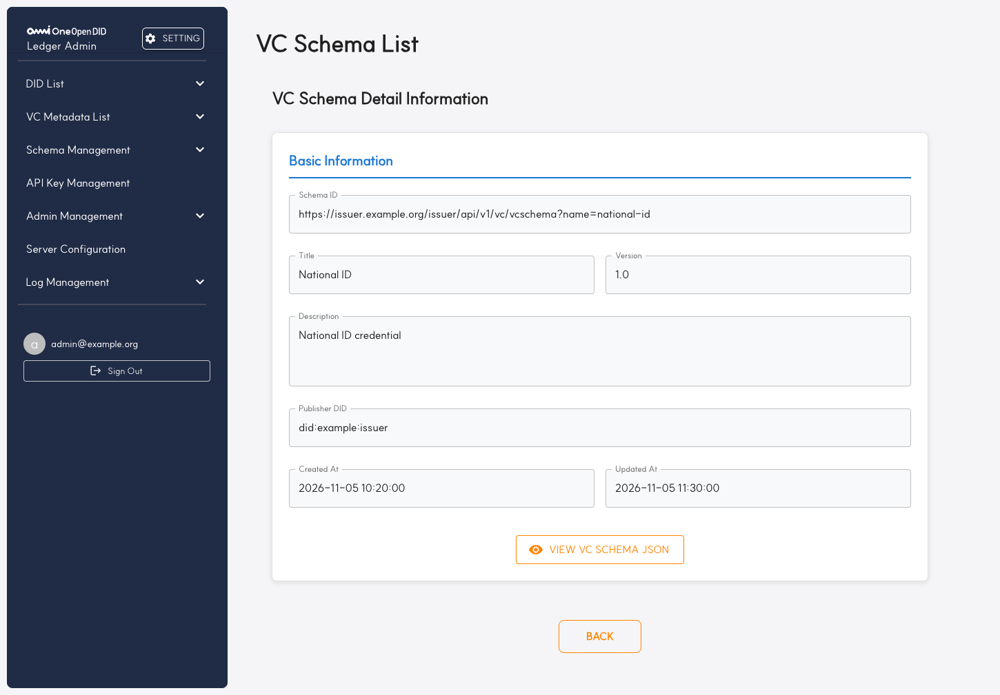

상세 화면은 Schema ID, Title, Version, Description, Publisher DID, Created At, Updated At을 표시하고, 버튼으로 VC Schema JSON을 팝업에 표시합니다. `BACK` 버튼은 목록으로 돌아갑니다.

 

### 3.3.2. ZKP Credential Schema List

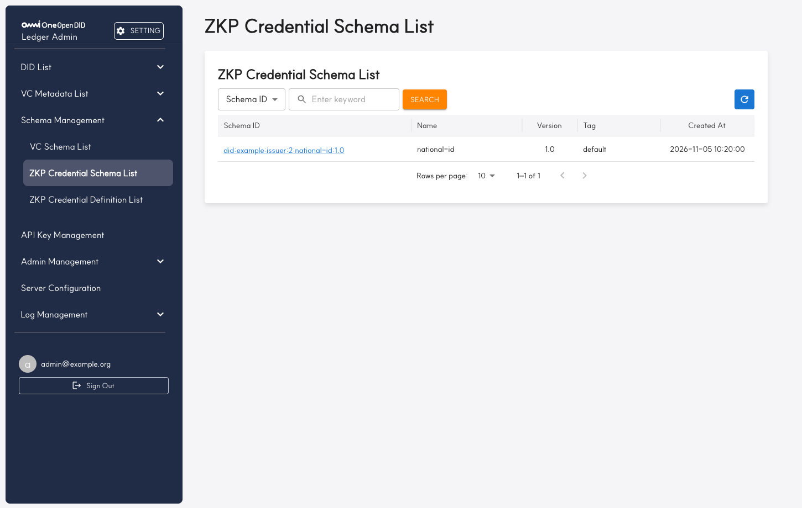

| 번호 | 항목 | 설명 |
| --- | --- | --- |
| 1 | **검색** | Schema ID, Name, Version, Tag로 검색합니다. |
| 2 | **Schema ID** | Credential Schema 식별자입니다. 클릭하면 상세 화면으로 이동합니다. |
| 3 | **Name** | 스키마 이름입니다. |
| 4 | **Version** | 스키마 버전입니다. |
| 5 | **Tag** | 태그입니다. |
| 6 | **Created At** | 등록 일시입니다. |

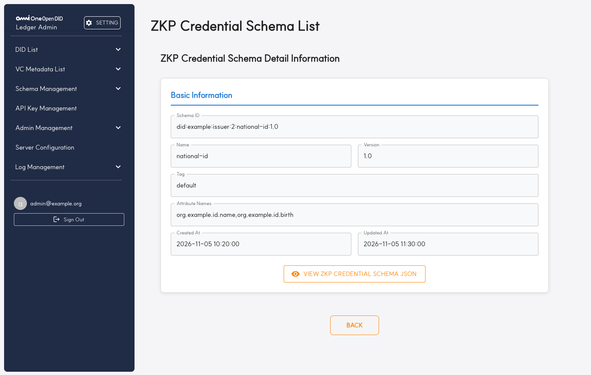

상세 화면은 Schema ID, Name, Version, Tag, Attribute Names, Created At, Updated At을 표시하고, 버튼으로 Credential Schema JSON을 팝업에 표시합니다.

 

### 3.3.3. ZKP Credential Definition List

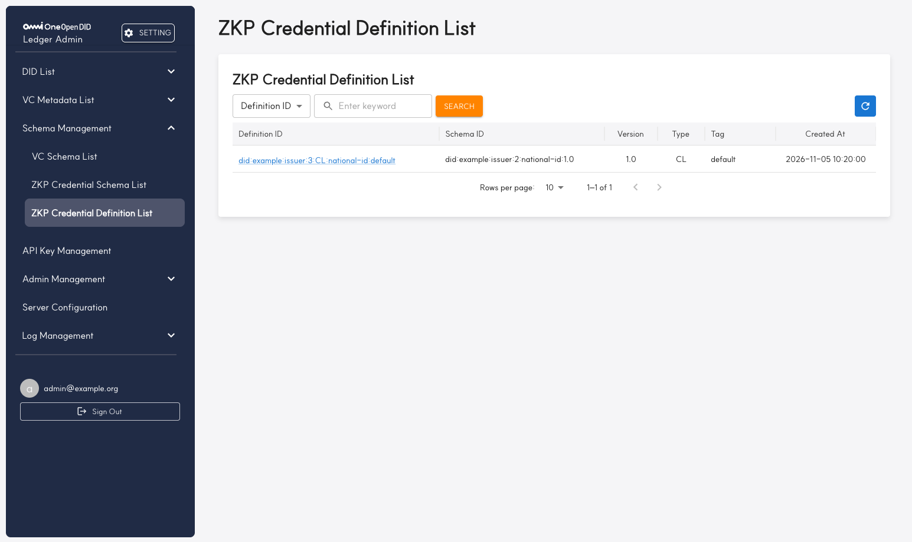

| 번호 | 항목 | 설명 |
| --- | --- | --- |
| 1 | **검색** | Definition ID, Schema ID, Version, Tag로 검색합니다. |
| 2 | **Definition ID** | Credential Definition 식별자입니다. 클릭하면 상세 화면으로 이동합니다. |
| 3 | **Schema ID** | 연결된 Credential Schema 식별자입니다. |
| 4 | **Version** | 버전입니다. |
| 5 | **Type** | 유형입니다. 예: `CL` |
| 6 | **Tag** | 태그입니다. |
| 7 | **Created At** | 등록 일시입니다. |

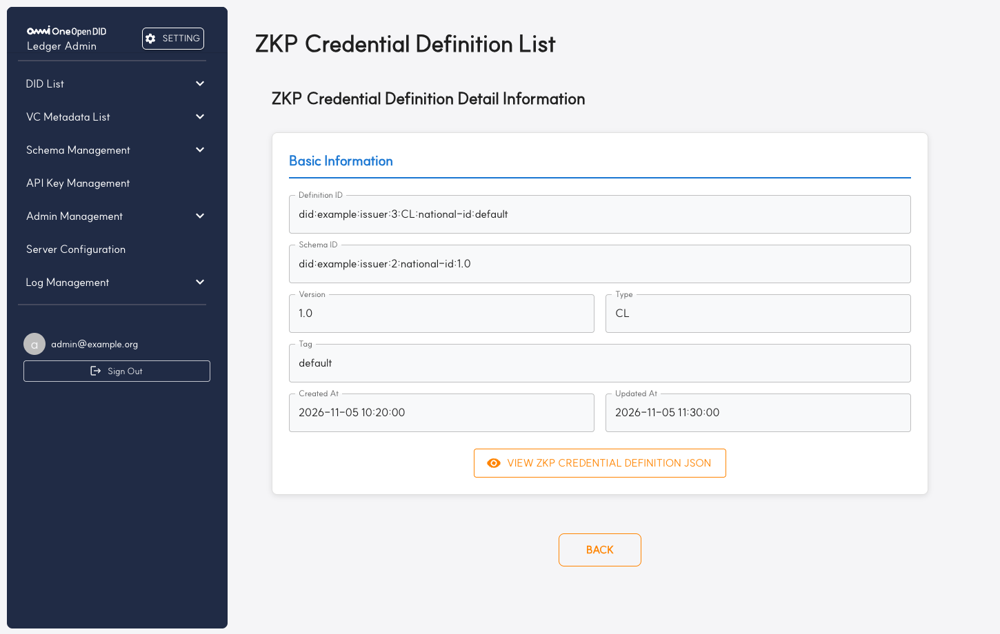

상세 화면은 Definition ID, Schema ID, Version, Type, Tag, Created At, Updated At을 표시하고, 버튼으로 Credential Definition JSON을 팝업에 표시합니다.

 

## 3.4. API Key Management

다른 서버가 Agent API(`/lss/api/v1`)를 호출할 때 쓰는 API Key를 발급하고 관리합니다. Role별 호출 가능 API와 오류 코드는 [설치 및 운영 가이드 8장](../installation/OpenDID_LedgerService_InstallationAndOperation_Guide_ko.md#8-api-key-운영)을 참고하세요.

 

### 3.4.1. API Key 목록 조회

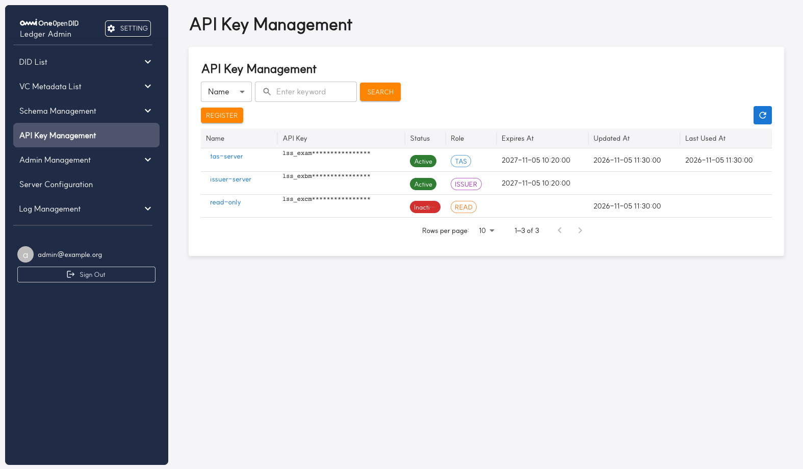

| 번호 | 항목 | 설명 |
| --- | --- | --- |
| 1 | **검색** | Name, Role(TAS, ISSUER, READ), Status(Active, Inactive)로 검색합니다. |
| 2 | **REGISTER 버튼** | API Key 발급 창을 엽니다. |
| 3 | **Name** | API Key 이름입니다. 클릭하면 상세 창이 열립니다. |
| 4 | **API Key** | 일부를 가린 API Key입니다. |
| 5 | **Status** | `Active` 또는 `Inactive`입니다. |
| 6 | **Role** | `TAS`, `ISSUER`, `READ` 중 하나입니다. |
| 7 | **Expires At** | 만료 일시입니다. |
| 8 | **Updated At** | 마지막으로 수정된 일시입니다. |
| 9 | **Last Used At** | 마지막으로 사용된 일시입니다. |

 

### 3.4.2. API Key 발급

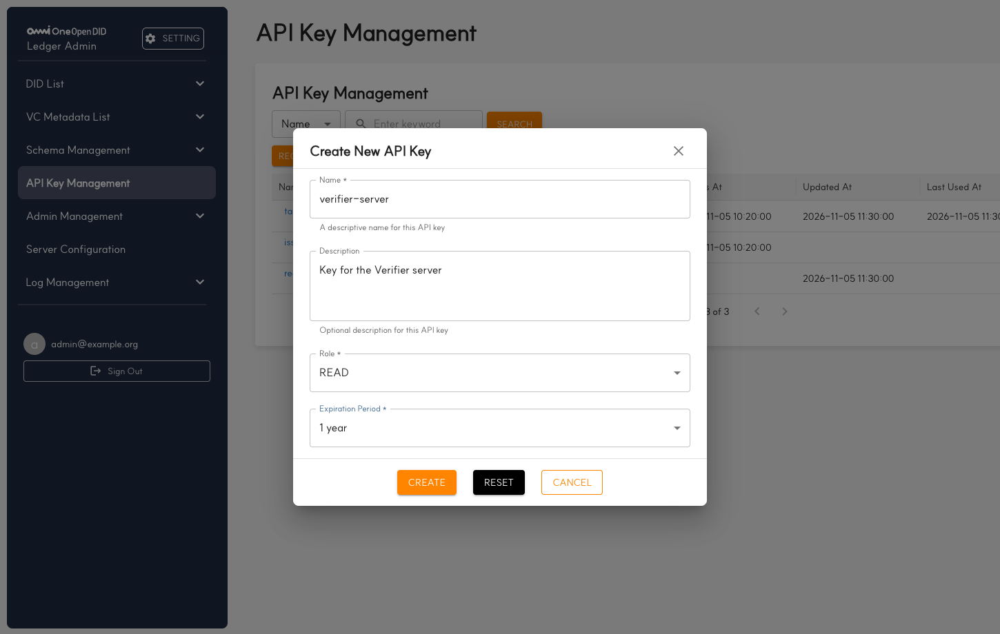

| 번호 | 항목 | 설명 |
| --- | --- | --- |
| 1 | **Name*** | API Key를 식별할 이름입니다(100자 이내). 예: `verifier-server` |
| 2 | **Description** | 용도입니다(500자 이내). 예: `Key for the Verifier server` |
| 3 | **Role*** | `TAS`, `ISSUER`, `READ` 중에서 선택합니다. |
| 4 | **Expiration Period*** | `1 month`, `3 months`, `6 months`, `1 year`, `2 years`, `No Limit`, `Custom` 중에서 선택합니다. |
| 5 | **Custom Expiration Days*** | `Custom`을 선택했을 때 일 단위로 입력합니다(30~36525일). |
| 6 | **CREATE 버튼** | API Key를 발급합니다. |
| 7 | **RESET 버튼** | 입력값을 초기화합니다. |
| 8 | **CANCEL 버튼** | 발급을 취소합니다. |

발급이 끝나면 `lss_`로 시작하는 API Key가 표시됩니다.

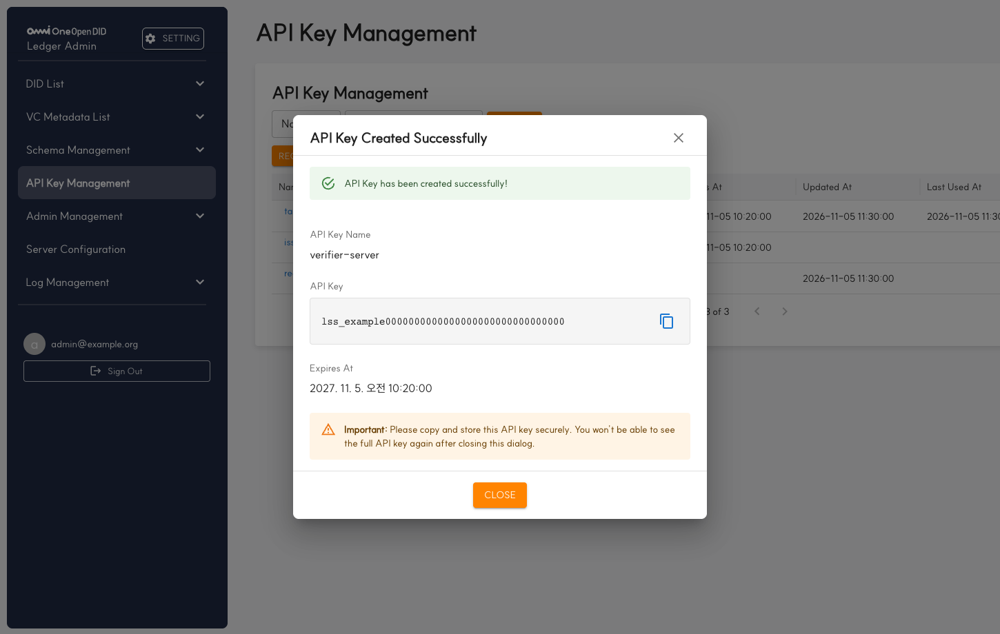

> **주의**: 평문 API Key는 이 화면에서 한 번만 표시됩니다. 창을 닫기 전에 복사해 호출 서버에 안전하게 전달하세요.

 

### 3.4.3. API Key 상세와 갱신, 비활성화

목록에서 Name을 클릭하면 상세 창이 열립니다.

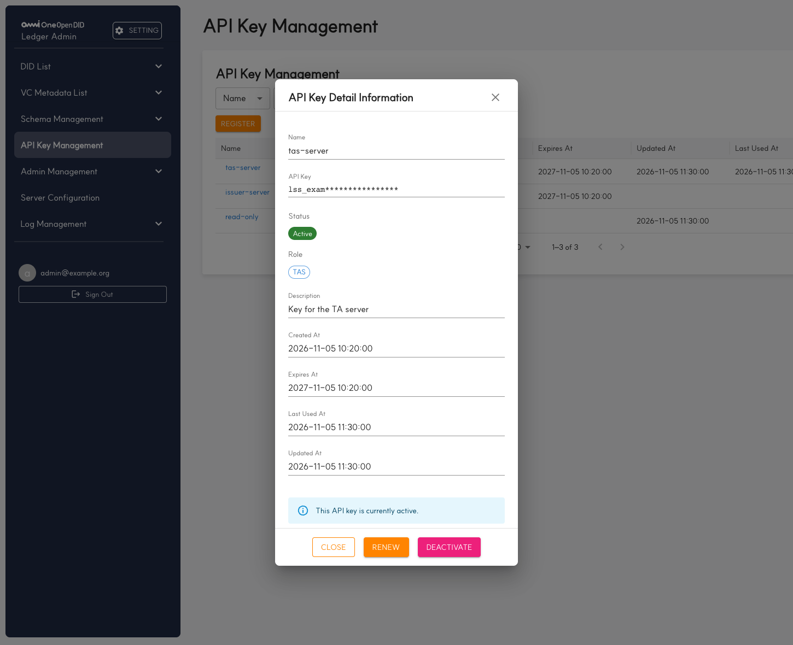

| 번호 | 항목 | 설명 |
| --- | --- | --- |
| 1 | **Status, Role** | 현재 상태와 Role입니다. |
| 2 | **Name, API Key, Description** | 이름, 일부를 가린 API Key, 설명입니다. |
| 3 | **Created At, Expires At, Last Used At, Updated At** | 생성, 만료, 마지막 사용, 마지막 수정 일시입니다. |
| 4 | **CLOSE 버튼** | 창을 닫습니다. |
| 5 | **RENEW 버튼** | Active 상태에서 만료일을 연장합니다. |
| 6 | **DEACTIVATE 버튼** | Active 상태에서 표시되며 API Key를 비활성화합니다. |
| 7 | **ACTIVATE 버튼** | Inactive 상태에서 표시되며 API Key를 다시 활성화합니다. |

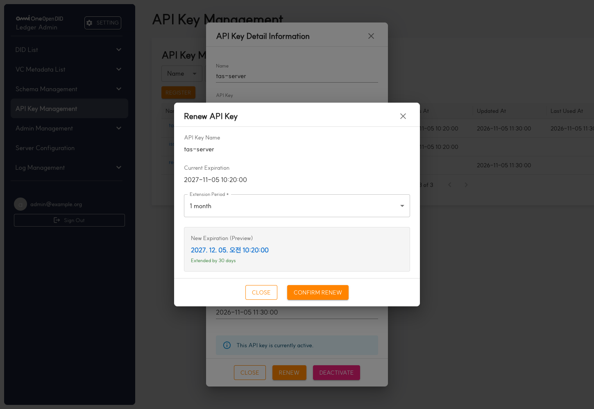

갱신 창에서는 `Extension Period`(`Custom`이면 `Custom Extension Days`)를 선택합니다. `New Expiration (Preview)`에서 새 만료 일시를 확인한 뒤 갱신합니다. API Key 값은 바뀌지 않습니다.

 

## 3.5. Admin Management

`Admin Management` 메뉴는 LSS Admin Console에 접근할 수 있는 관리자 계정을 관리하는 기능입니다.

LSS 서버를 설치하면 기본적으로 `admin@opendid.omnione.net` 계정이 ROOT 권한으로 자동 생성됩니다. 이 계정은 시스템 내 유일한 ROOT 계정이며, 삭제할 수 없습니다.

관리자 계정은 **ROOT**와 **Normal Admin** 두 가지 권한 유형으로 구분됩니다.

`REGISTER`, `DELETE`, `CHANGE PASSWORD`는 ROOT 관리자가 사용합니다.

 

### 3.5.1. Admin 목록 조회

`Admin Management` 메뉴에 진입하면 등록된 관리자 계정 목록이 표시됩니다.

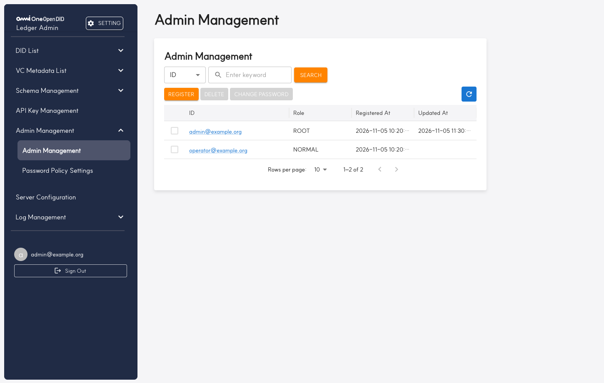

| 번호 | 항목 | 설명 |
| --- | --- | --- |
| 1 | **검색** | ID 또는 Role(Root, Normal)로 검색합니다. |
| 2 | **REGISTER 버튼** | 새 관리자 계정을 등록하는 화면으로 이동합니다. |
| 3 | **DELETE 버튼** | 선택한 관리자 계정을 삭제합니다. ROOT 관리자만 할 수 있습니다. |
| 4 | **CHANGE PASSWORD 버튼** | 선택한 관리자 계정의 비밀번호를 변경합니다. |
| 5 | **ID** | 관리자 계정의 이메일 ID입니다. |
| 6 | **Role** | 관리자 계정의 권한입니다. |
| 7 | **Registered At** | 계정이 등록된 일시입니다. |
| 8 | **Updated At** | 마지막으로 수정된 일시입니다. |

 

### 3.5.2. Admin 등록

`REGISTER` 버튼을 클릭하면 등록 화면으로 이동합니다.

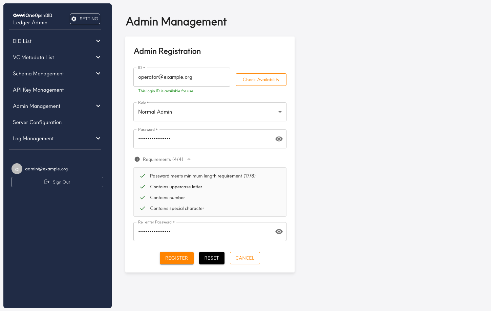

| 번호 | 항목 | 설명 |
| --- | --- | --- |
| 1 | **ID*** | 관리자 계정의 ID입니다. 이메일 형식 3~30자를 사용합니다. 예: `operator@example.org` |
| 2 | **Check Availability 버튼** | 입력한 ID가 중복되지 않는지 확인합니다. 등록하려면 확인을 통과해야 합니다. |
| 3 | **Role** | 관리자 계정의 권한을 선택합니다. 예: `Normal Admin` |
| 4 | **Password*** | 로그인에 사용할 비밀번호입니다(8~30자). 비밀번호 정책이 켜져 있으면 해당 규칙도 적용됩니다. |
| 5 | **Re-enter Password*** | 비밀번호를 한 번 더 입력합니다. |
| 6 | **REGISTER 버튼** | 입력한 정보로 관리자 계정을 등록합니다. |
| 7 | **RESET 버튼** | 입력값을 초기화합니다. |
| 8 | **CANCEL 버튼** | 등록을 취소하고 이전 화면으로 돌아갑니다. |

 

## 3.6. Password Policy Settings

`Admin Management > Password Policy Settings`에서 관리자 비밀번호 규칙을 설정합니다. 규칙은 계정을 등록할 때와 비밀번호를 변경할 때 적용됩니다.

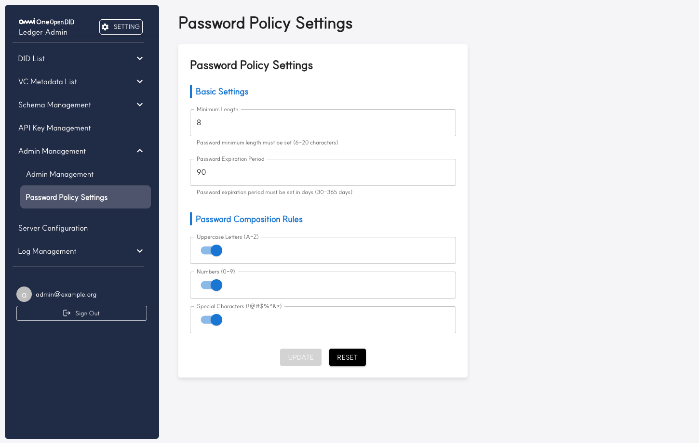

| 번호 | 항목 | 설명 |
| --- | --- | --- |
| 1 | **Minimum Length** | 비밀번호 최소 길이입니다. 6~20자로 설정합니다. 기본값은 8입니다. |
| 2 | **Password Expiration Period** | 비밀번호 만료 기간입니다. 30~365일로 설정합니다. 기본값은 365입니다. |
| 3 | **Uppercase Letters (A-Z)** | 대문자를 1자 이상 포함하게 합니다. 기본값은 꺼짐입니다. |
| 4 | **Numbers (0-9)** | 숫자를 1자 이상 포함하게 합니다. 기본값은 꺼짐입니다. |
| 5 | **Special Characters (!@#$%^&*)** | 특수문자를 1자 이상 포함하게 합니다. 기본값은 꺼짐입니다. |
| 6 | **UPDATE 버튼** | 정책을 저장합니다. 아직 등록하지 않았다면 버튼 이름은 `REGISTER`입니다. |
| 7 | **RESET 버튼** | 변경 전 입력 상태로 되돌립니다. |

## 3.7. Server Configuration

`Server Configuration`에서 Agent API의 API Key 검증 사용 여부를 설정합니다.

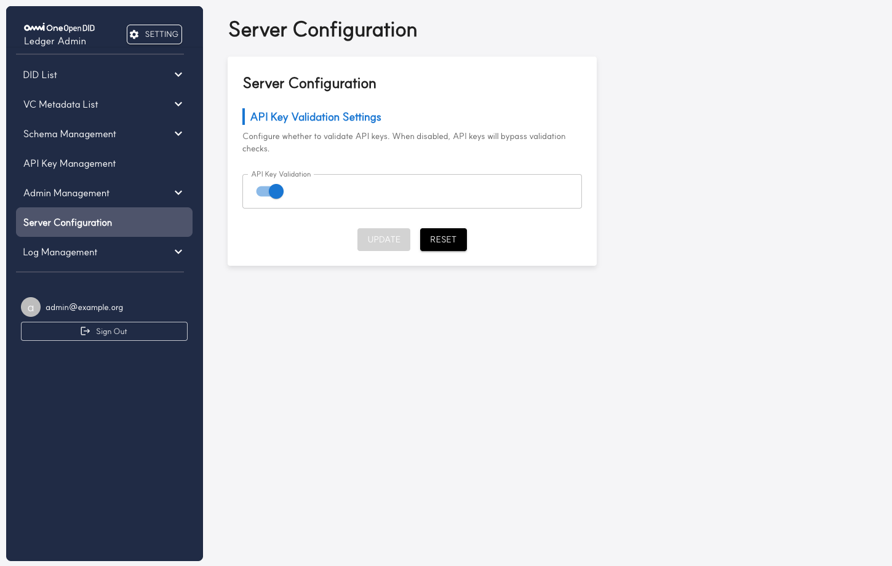

| 번호 | 항목 | 설명 |
| --- | --- | --- |
| 1 | **API Key Validation** | 켜면 Agent API 호출에서 API Key를 검증합니다. `API_KEY_VALIDATION_ENABLED`로 저장되며 초기값은 꺼짐입니다. 서버를 재시작하지 않아도 이후 요청부터 적용됩니다. |
| 2 | **UPDATE 버튼** | 설정을 저장합니다. |
| 3 | **RESET 버튼** | 저장 전 입력값을 되돌립니다. |

> **주의**: 초기값에서는 API Key 없이 모든 Agent API를 호출할 수 있습니다. 운영 환경에서는 호출 서버에 API Key를 먼저 설정한 뒤 켜세요. 적용 순서는 [설치 및 운영 가이드 8.4](../installation/OpenDID_LedgerService_InstallationAndOperation_Guide_ko.md#84-api-key-검증-활성화)를 참고하세요.

## 3.8. Log Management

LSS 등록이 완료되면 사이드바의 `Log Management`에서 API 호출 기록을 조회할 수 있습니다. 두 화면 모두 최신 기록부터 페이지별로 표시하고, 새로고침 버튼으로 목록을 다시 불러옵니다. `Called At`을 클릭하면 상세 창이 열립니다. 로그는 조회 전용입니다.

 

### 3.8.1. API Log

`Log Management > API Log`(`/logs/api`)는 LSS Agent API 호출 기록을 보여줍니다.

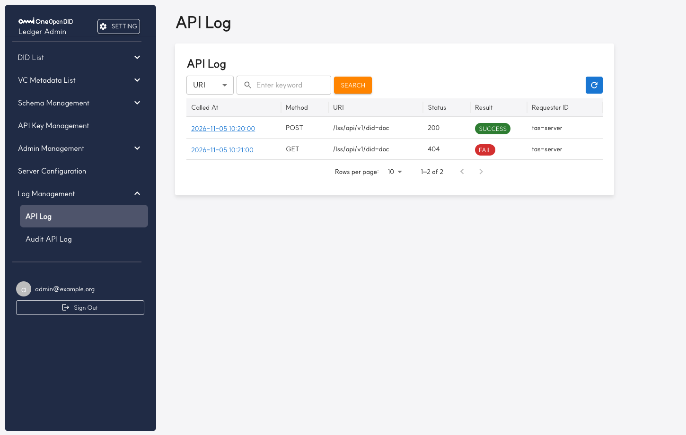

| 번호 | 항목 | 설명 |
| --- | --- | --- |
| 1 | **검색** | `URI` 또는 `Result`(`SUCCESS`, `FAIL`)로 검색합니다. |
| 2 | **Called At** | 호출 일시입니다. 클릭하면 상세 창이 열립니다. |
| 3 | **Method** | HTTP 메서드입니다. |
| 4 | **URI** | 호출한 URI입니다. |
| 5 | **Status** | HTTP 상태 코드입니다. |
| 6 | **Result** | `SUCCESS` 또는 `FAIL`입니다. |
| 7 | **Requester ID** | 요청자 ID입니다. |

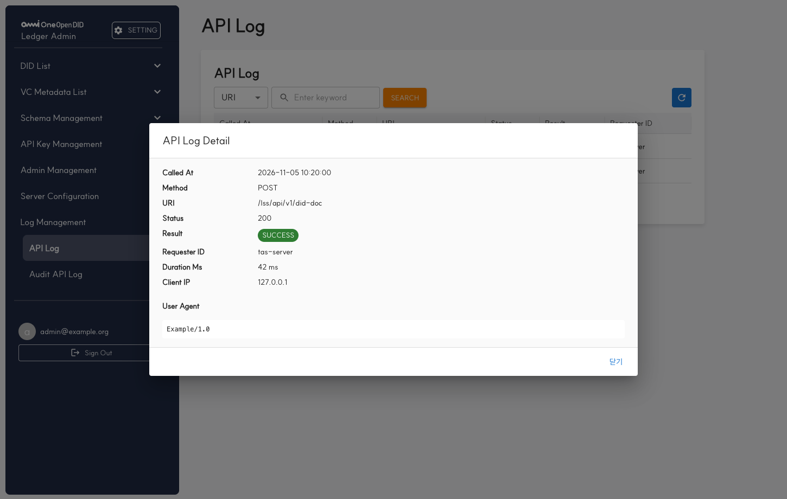

상세 창은 목록 항목에 더해 다음을 표시합니다.

| 항목 | 설명 |
| --- | --- |
| **Duration Ms** | 처리 시간(밀리초)입니다. |
| **Client IP** | 클라이언트 IP입니다. |
| **User Agent** | 요청의 User Agent입니다. |
| **Message** | 오류 메시지가 기록된 경우 표시합니다. |

 

### 3.8.2. Audit API Log

`Log Management > Audit API Log`(`/logs/audit`)는 Admin API의 관리자 작업 기록을 보여줍니다.

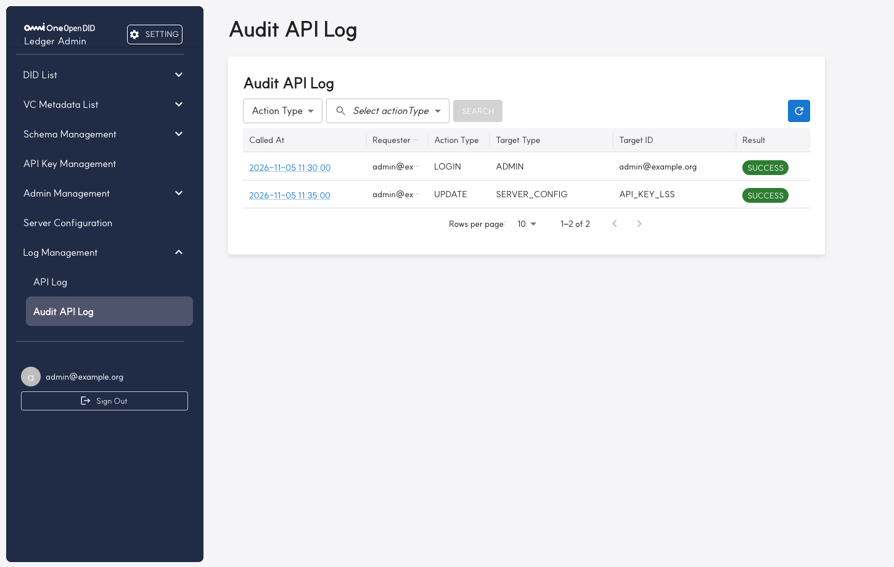

| 번호 | 항목 | 설명 |
| --- | --- | --- |
| 1 | **검색** | `Action Type`, `Target Type`, `Result`, `Requester ID`로 검색합니다. `Action Type`은 `NONE`, `CREATE`, `UPDATE`, `DELETE`, `LOGIN`, `LOGOUT` 중에서 선택합니다. |
| 2 | **Called At** | 호출 일시입니다. 클릭하면 상세 창이 열립니다. |
| 3 | **Requester ID** | 작업한 관리자 ID입니다. |
| 4 | **Action Type** | 작업 유형입니다. |
| 5 | **Target Type** | 작업 대상의 유형입니다. |
| 6 | **Target ID** | 작업 대상의 ID입니다. |
| 7 | **Result** | `SUCCESS` 또는 `FAIL`입니다. |

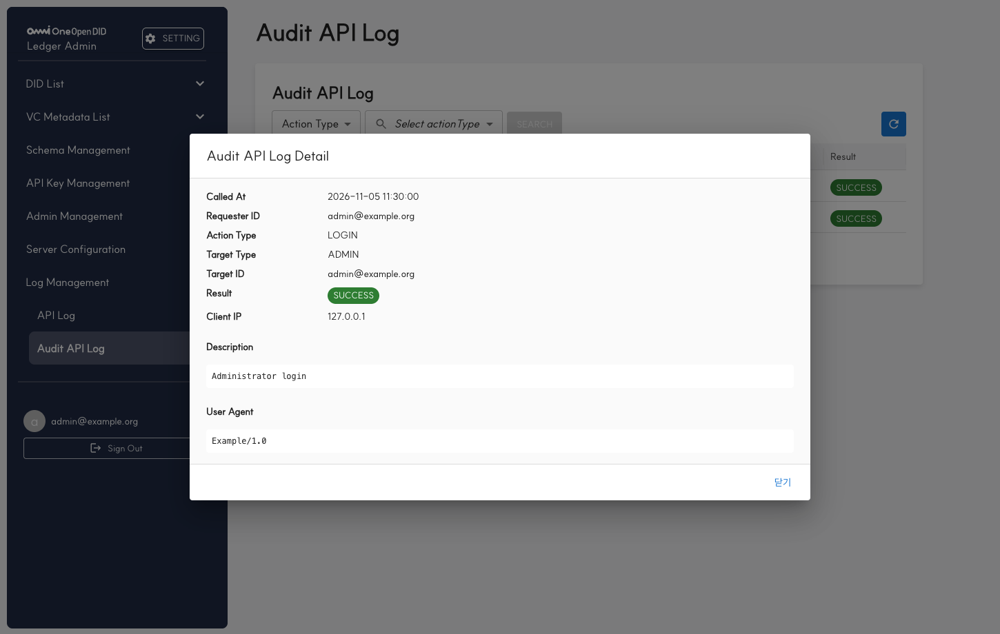

상세 창은 목록 항목에 더해 다음을 표시합니다.

| 항목 | 설명 |
| --- | --- |
| **Client IP** | 클라이언트 IP입니다. |
| **Description** | 작업 설명입니다. |
| **User Agent** | 요청의 User Agent입니다. |
| **Message** | 오류 메시지가 기록된 경우 표시합니다. |

> 로그는 서버의 `@ArticleLog`가 적용된 API 호출에서 생성됩니다. 결과가 `FAIL`이면 API Log의 상태 코드와 해당 로그의 상세 메시지를 확인하세요.

